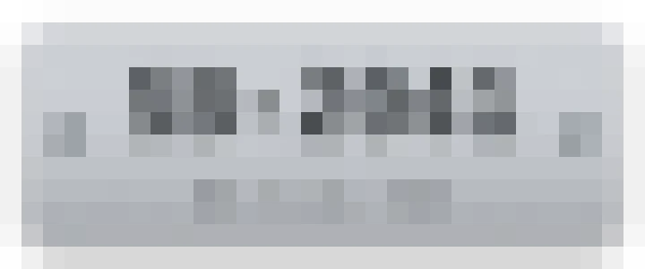
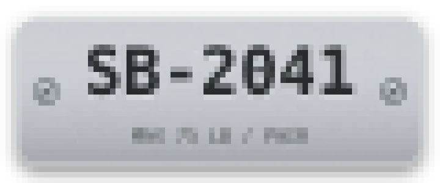
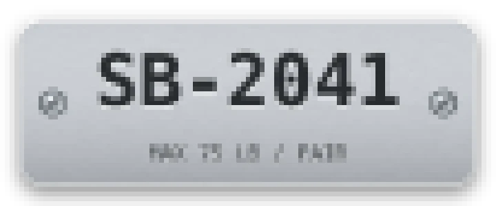

It is a Saturday afternoon in aisle 14. A store associate holds a phone up to a steel shelf bracket and asks, out loud: *"Will this hold a 30-inch microwave?"*

It's one short sentence. Answering it well takes five separate skills. The system has to **see** which bracket is in the photo. It has to **read** the part number stamped on it, which is about forty pixels tall in a twelve-megapixel image. It has to **look up** that part's load rating in a spec sheet that was published after any model was trained. It has to **know** what a 30-inch microwave weighs. And it has to **answer**, aloud, within a couple of seconds, with a source the associate can trust.

No single model does all five. A vision-language model (VLM) can see and read. Retrieval-augmented generation (RAG) can look things up. A large language model (LLM) can reason over whatever the other two hand it. The interesting engineering is in how they pass the question along. I built a voice assistant for store associates along these lines, combining RAG, VLM visual grounding and streaming LLM inference. The scenario in this post is a composite with made-up part numbers, but the shape of the problem is real.

So let's follow that one question through the whole system, stage by stage. At each stop we'll look at how the part works, the bit of maths that explains its behaviour, and the specific way it could get *this* question wrong. If you only want the big picture, the short summaries at the top of each section will carry you through.

<figure class="diagram">
<svg viewBox="0 0 760 170" role="img" aria-labelledby="fig0-title">
<title id="fig0-title">The question's path: a photo and a spoken question go to a VLM that reads the label, then a query rewrite, then hybrid retrieval and reranking, then page-image search, then an LLM that answers with sources</title>
<defs><marker id="arr0" viewBox="0 0 10 10" refX="9" refY="5" markerWidth="7" markerHeight="7" orient="auto-start-reverse"><path d="M0,0 L10,5 L0,10 z" class="d-arrowhead"/></marker></defs>
<text x="10" y="24" class="d-label">§1–2 SEE</text>
<text x="162" y="24" class="d-label">§3 ASK</text>
<text x="314" y="24" class="d-label">§3 RETRIEVE</text>
<text x="466" y="24" class="d-label">§4 READ PAGES</text>
<text x="618" y="24" class="d-label">§5–6 ANSWER</text>
<rect x="10" y="36" width="124" height="76" rx="8" class="d-box"/>
<text x="72" y="68" class="d-text" text-anchor="middle">VLM</text><text x="72" y="88" class="d-muted" text-anchor="middle">reads the label</text>
<rect x="162" y="36" width="124" height="76" rx="8" class="d-box"/>
<text x="224" y="68" class="d-text" text-anchor="middle">Rewrite</text><text x="224" y="88" class="d-muted" text-anchor="middle">a standalone query</text>
<rect x="314" y="36" width="124" height="76" rx="8" class="d-box d-acc"/>
<text x="376" y="68" class="d-text" text-anchor="middle">Hybrid search</text><text x="376" y="88" class="d-muted" text-anchor="middle">BM25 + dense, rerank</text>
<rect x="466" y="36" width="124" height="76" rx="8" class="d-box"/>
<text x="528" y="68" class="d-text" text-anchor="middle">Page images</text><text x="528" y="88" class="d-muted" text-anchor="middle">late interaction</text>
<rect x="618" y="36" width="124" height="76" rx="8" class="d-box"/>
<text x="680" y="68" class="d-text" text-anchor="middle">LLM</text><text x="680" y="88" class="d-muted" text-anchor="middle">answer + sources</text>
<path d="M134 74 H158" class="d-line" marker-end="url(#arr0)"/>
<path d="M286 74 H310" class="d-line" marker-end="url(#arr0)"/>
<path d="M438 74 H462" class="d-line" marker-end="url(#arr0)"/>
<path d="M590 74 H614" class="d-line" marker-end="url(#arr0)"/>
<text x="10" y="150" class="d-muted">Every arrow is a hand-off where an error can enter, and nothing downstream can repair it.</text>
</svg>
<figcaption>Fig. 1. The route the question takes. Section numbers refer to this post.</figcaption>
</figure>

## Notation

| Symbol | Meaning |
|---|---|
| $$x_v,\ x_q$$ | an image; a text query |
| $$f(\cdot),\ g(\cdot)$$ | image encoder; text encoder (each returns a vector) |
| $$N$$ | batch size, or number of candidates |
| $$t,\ \tau$$ | logit scale and temperature, $$t = 1/\tau$$ |
| $$z$$ | a retrieved chunk of text, or a page |
| $$\mathbf{q}_i,\ \mathbf{d}_j$$ | the $$i$$-th query-token vector; the $$j$$-th page-patch vector |

## 1. Seeing: how images and words end up in one space

> **In short:** CLIP learns by playing a matching game between photos and captions. That makes it very good at *what* is in a picture, and surprisingly bad at small print, word order and exact numbers.

Before anything can talk about the bracket, the photo and the words "shelf bracket" need to land near each other in some vector space. The model that made this practical is **CLIP** (Radford et al. 2021).

Think of it as a matching game. CLIP trains an image encoder $$f$$ and a text encoder $$g$$ on 400 million image-caption pairs from the web, with no class labels at all. The only signal is which caption came with which image. Take a batch of $$N$$ pairs and score every combination, $$s_{ij} = t \cdot \cos\big(f(x_i), g(y_j)\big)$$. The true pairs sit on the diagonal of that $$N \times N$$ grid. The loss asks each image to pick out its caption, and each caption its image:

$$
\mathcal{L}_{\text{CLIP}} = -\frac{1}{2N}\sum_{i=1}^{N}\left[\log\frac{e^{s_{ii}}}{\sum_{j} e^{s_{ij}}} + \log\frac{e^{s_{ii}}}{\sum_{j} e^{s_{ji}}}\right]
$$

This is called the **InfoNCE** loss (Oord et al. 2018), and there's a neat result hiding in it. Making the loss small pushes up a lower bound on the *mutual information* between images and captions, which is roughly how much knowing one tells you about the other:

$$
I(X; Y) \;\ge\; \log N - \mathcal{L}_{\text{InfoNCE}}
$$

Here's the catch: the bound can never go above $$\log N$$, however good the encoders get. A batch of 256 can prove at most 5.5 nats of shared information. To learn fine distinctions, the model needs lots of wrong answers to compare against in every batch. That's why CLIP was trained with batches of 32,768.

<figure class="chart" id="chart-lognbound">
<svg viewBox="0 0 680 320" role="img" aria-labelledby="ch1-t"><title id="ch1-t">Line chart: the most information a contrastive batch can certify grows as log N, from 0.7 nats at N = 2 to 10.4 nats at N = 32,768</title><line x1="64" x2="640" y1="262.0" y2="262.0" class="c-grid"/>
<text x="56" y="266.0" class="c-tick" text-anchor="end">0</text>
<line x1="64" x2="640" y1="222.4" y2="222.4" class="c-grid"/>
<text x="56" y="226.4" class="c-tick" text-anchor="end">2</text>
<line x1="64" x2="640" y1="182.7" y2="182.7" class="c-grid"/>
<text x="56" y="186.7" class="c-tick" text-anchor="end">4</text>
<line x1="64" x2="640" y1="143.1" y2="143.1" class="c-grid"/>
<text x="56" y="147.1" class="c-tick" text-anchor="end">6</text>
<line x1="64" x2="640" y1="103.5" y2="103.5" class="c-grid"/>
<text x="56" y="107.5" class="c-tick" text-anchor="end">8</text>
<line x1="64" x2="640" y1="63.8" y2="63.8" class="c-grid"/>
<text x="56" y="67.8" class="c-tick" text-anchor="end">10</text>
<line x1="64" x2="640" y1="262" y2="262" class="c-axis"/>
<text x="64.0" y="280" class="c-tick" text-anchor="middle">2</text>
<text x="187.4" y="280" class="c-tick" text-anchor="middle">16</text>
<text x="310.9" y="280" class="c-tick" text-anchor="middle">128</text>
<text x="434.3" y="280" class="c-tick" text-anchor="middle">1k</text>
<text x="557.7" y="280" class="c-tick" text-anchor="middle">8k</text>
<text x="640.0" y="280" class="c-tick" text-anchor="middle">32k</text>
<text x="352.0" y="302" class="c-axis-title" text-anchor="middle">Batch size N (log scale)</text>
<text x="56" y="30" class="c-axis-title" text-anchor="start">Ceiling on what the loss can certify, nats</text><path d="M64.0,248.3 L105.1,234.5 L146.3,220.8 L187.4,207.1 L228.6,193.3 L269.7,179.6 L310.9,165.8 L352.0,152.1 L393.1,138.4 L434.3,124.6 L475.4,110.9 L516.6,97.2 L557.7,83.4 L598.9,69.7 L640.0,55.9" class="c-line c-accent"/><g><title>N = 2: 0.69 nats</title><circle cx="64.0" cy="248.3" r="9" class="c-hit"/></g><g><title>N = 4: 1.39 nats</title><circle cx="105.1" cy="234.5" r="9" class="c-hit"/></g><g><title>N = 8: 2.08 nats</title><circle cx="146.3" cy="220.8" r="9" class="c-hit"/></g><g><title>N = 16: 2.77 nats</title><circle cx="187.4" cy="207.1" r="9" class="c-hit"/></g><g><title>N = 32: 3.47 nats</title><circle cx="228.6" cy="193.3" r="9" class="c-hit"/></g><g><title>N = 64: 4.16 nats</title><circle cx="269.7" cy="179.6" r="9" class="c-hit"/></g><g><title>N = 128: 4.85 nats</title><circle cx="310.9" cy="165.8" r="9" class="c-hit"/></g><g><title>N = 256: 5.55 nats</title><circle cx="352.0" cy="152.1" r="9" class="c-hit"/></g><g><title>N = 512: 6.24 nats</title><circle cx="393.1" cy="138.4" r="9" class="c-hit"/></g><g><title>N = 1,024: 6.93 nats</title><circle cx="434.3" cy="124.6" r="9" class="c-hit"/></g><g><title>N = 2,048: 7.62 nats</title><circle cx="475.4" cy="110.9" r="9" class="c-hit"/></g><g><title>N = 4,096: 8.32 nats</title><circle cx="516.6" cy="97.2" r="9" class="c-hit"/></g><g><title>N = 8,192: 9.01 nats</title><circle cx="557.7" cy="83.4" r="9" class="c-hit"/></g><g><title>N = 16,384: 9.70 nats</title><circle cx="598.9" cy="69.7" r="9" class="c-hit"/></g><g><title>N = 32,768: 10.40 nats</title><circle cx="640.0" cy="55.9" r="9" class="c-hit"/></g><g><title>N = 256: log N = 5.55 nats</title><circle cx="352.0" cy="152.1" r="12" class="c-hit"/><circle cx="352.0" cy="152.1" r="5" class="c-dot c-accent-fill"/></g><text x="362.0" y="174.1" class="c-label" text-anchor="start">batch of 256: at most 5.5 nats</text><g><title>N = 32,768: log N = 10.40 nats</title><circle cx="640.0" cy="55.9" r="12" class="c-hit"/><circle cx="640.0" cy="55.9" r="5" class="c-dot c-accent-fill"/></g><text x="630.0" y="43.9" class="c-label" text-anchor="end">CLIP, batch of 32,768: 10.4 nats</text></svg>
<figcaption>Fig. 2. However good the encoders get, InfoNCE can certify at most log N nats. Doubling the batch adds only 0.69 nats, which is why contrastive models are trained with enormous batches.</figcaption>
<details class="chart-data"><summary>Show the data</summary><table><thead><tr><th>Batch size N</th><th>log N (nats)</th></tr></thead><tbody><tr><td>2</td><td>0.69</td></tr><tr><td>16</td><td>2.77</td></tr><tr><td>128</td><td>4.85</td></tr><tr><td>256</td><td>5.55</td></tr><tr><td>1,024</td><td>6.93</td></tr><tr><td>8,192</td><td>9.01</td></tr><tr><td>32,768</td><td>10.40</td></tr></tbody></table></details>
</figure>
 The scale $$t$$ is learned too. It starts at $$1/0.07$$ and is capped at 100, and it controls how sharply the softmax separates the best match from the rest.

**SigLIP** (Zhai et al. 2023) removes the batch-wide softmax. Every pair becomes an independent yes-or-no question:

$$
\mathcal{L}_{\text{SigLIP}} = -\frac{1}{N}\sum_{i=1}^{N}\sum_{j=1}^{N} \log \sigma\!\big(z_{ij}\,(t\,\mathbf{x}_i^\top \mathbf{y}_j + b)\big), \qquad z_{ij} = \begin{cases} +1 & i = j \\ -1 & i \ne j \end{cases}
$$

Without a softmax over the batch, the loss no longer needs every device to see every other device's embeddings, so it scales cheaply and works well at modest batch sizes. The bias $$b$$ starts at $$-10$$ because only $$N$$ of the $$N^2$$ pairs are positive. Most modern VLMs use a SigLIP-family image encoder. Here are both losses in NumPy:

```python
import numpy as np

def normalize(x):
    return x / np.linalg.norm(x, axis=-1, keepdims=True)

def log_softmax(z, axis):
    z = z - z.max(axis=axis, keepdims=True)
    return z - np.log(np.exp(z).sum(axis=axis, keepdims=True))

def clip_loss(img, txt, t=1 / 0.07):
    """Symmetric InfoNCE. Row i of img and txt is a matching pair."""
    logits = t * normalize(img) @ normalize(txt).T            # (N, N) scaled cosines
    i2t = -np.diag(log_softmax(logits, axis=1)).mean()        # each image picks its caption
    t2i = -np.diag(log_softmax(logits, axis=0)).mean()        # each caption picks its image
    return (i2t + t2i) / 2

def siglip_loss(img, txt, t=10.0, b=-10.0):
    """Pairwise sigmoid loss: every (i, j) is its own yes/no question."""
    logits = t * normalize(img) @ normalize(txt).T + b
    labels = 2 * np.eye(len(logits)) - 1                      # +1 on the diagonal, -1 elsewhere
    return np.logaddexp(0, -labels * logits).sum() / len(logits)   # sum of -log sigmoid

rng = np.random.default_rng(0)
N, d = 256, 64
img = rng.normal(size=(N, d))
txt = img + 0.8 * rng.normal(size=(N, d))                     # captions near their images
shuffled = txt[rng.permutation(N)]                            # same captions, wrong pairs

for name, t in [("aligned", txt), ("shuffled", shuffled)]:
    print(f"{name:9s} CLIP {clip_loss(img, t):6.3f}   SigLIP {siglip_loss(img, t):6.3f}")
print(f"log N = {np.log(N):.2f}; bound on mutual information: {np.log(N) - clip_loss(img, txt):.2f} nats")
```

```
aligned   CLIP  0.026   SigLIP  2.371
shuffled  CLIP 10.914   SigLIP  9.993
log N = 5.55; bound on mutual information: 5.52 nats
```

Two things jump out. With well-aligned pairs, the bound sits right up against its $$\log N$$ ceiling. The batch size, not the encoder, has become the limit. And SigLIP's loss is still well above zero on aligned pairs, because with $$t = 10$$ and $$b = -10$$ a positive pair needs a cosine close to 1 before its logit turns positive. Training learns $$t$$ and $$b$$; the initial values encode the prior that almost every pair is negative.

### What contrastive models cannot see

For our bracket question, the interesting part is what this matching game does *not* teach.

**Word order and relations.** Web captions rarely need word order to be matched to their image, so contrastive models often behave like bags of words. Yuksekgonul et al. (2023) show CLIP struggling to tell "the horse is eating the grass" from "the grass is eating the horse". "A bracket under the shelf" and "a shelf under the bracket" look almost the same to it. Their fix, NegCLIP, adds hard negatives with swapped word order to each batch, which is the bound above at work: the model only learns distinctions that its negatives force it to make.

**Small text.** A caption describes the scene, not a part number in the corner. Global image embeddings capture "a metal bracket on a wall" well and "SB-2041" barely at all.

**The modality gap.** Liang et al. (2022) found that image embeddings and text embeddings sit in two separate narrow cones of the shared space. Image-to-text cosine scores are therefore systematically lower than text-to-text scores. In practice, never reuse a similarity threshold across modalities. A cut-off tuned on text-to-text search will reject good image matches.

So CLIP gives the system a good sense of *what* is in the photo. To read the label and answer in words, we need a language model on top.

## 2. From pixels to tokens: connecting vision to a language model

> **In short:** a VLM turns a photo into a few hundred "visual words" that an LLM can read. The catch is resolution. Shrink the photo to fit, and the part number turns to mush.

A VLM's job is to hand what the camera saw to a language model. There are three broad ways to do it.

<figure class="diagram">
<svg viewBox="0 0 760 210" role="img" aria-labelledby="fig1-title">
<title id="fig1-title">A vision-language model: image to vision encoder to projector to visual tokens, joined with text tokens and fed to an LLM</title>
<defs><marker id="arr1" viewBox="0 0 10 10" refX="9" refY="5" markerWidth="7" markerHeight="7" orient="auto-start-reverse"><path d="M0,0 L10,5 L0,10 z" class="d-arrowhead"/></marker></defs>
<rect x="10" y="30" width="96" height="70" rx="8" class="d-box"/>
<text x="58" y="62" class="d-text" text-anchor="middle">Image</text><text x="58" y="80" class="d-muted" text-anchor="middle" font-style="italic">x<tspan baseline-shift="sub" font-size="9">v</tspan></text>
<rect x="140" y="30" width="118" height="70" rx="8" class="d-box"/>
<text x="199" y="62" class="d-text" text-anchor="middle">Vision encoder</text><text x="199" y="80" class="d-muted" text-anchor="middle">ViT (frozen)</text>
<rect x="292" y="30" width="96" height="70" rx="8" class="d-box d-acc"/>
<text x="340" y="62" class="d-text" text-anchor="middle">Projector</text><text x="340" y="80" class="d-muted" text-anchor="middle">MLP, trained</text>
<g class="d-token"><rect x="424" y="38" width="16" height="16" rx="3"/><rect x="444" y="38" width="16" height="16" rx="3"/><rect x="464" y="38" width="16" height="16" rx="3"/><rect x="484" y="38" width="16" height="16" rx="3"/></g>
<text x="462" y="78" class="d-muted" text-anchor="middle">visual tokens</text>
<g class="d-token-text"><rect x="424" y="120" width="16" height="16" rx="3"/><rect x="444" y="120" width="16" height="16" rx="3"/><rect x="464" y="120" width="16" height="16" rx="3"/></g>
<text x="462" y="160" class="d-muted" text-anchor="middle">"Will this hold…?"</text>
<rect x="540" y="30" width="96" height="130" rx="8" class="d-box"/>
<text x="588" y="92" class="d-text" text-anchor="middle">LLM</text><text x="588" y="110" class="d-muted" text-anchor="middle">decoder</text>
<text x="700" y="100" class="d-text" text-anchor="middle">Answer</text>
<path d="M106 65 H136" class="d-line" marker-end="url(#arr1)"/>
<path d="M258 65 H288" class="d-line" marker-end="url(#arr1)"/>
<path d="M388 65 H418" class="d-line" marker-end="url(#arr1)"/>
<path d="M504 46 H536" class="d-line" marker-end="url(#arr1)"/>
<path d="M484 128 H536" class="d-line" marker-end="url(#arr1)"/>
<path d="M636 95 H664" class="d-line" marker-end="url(#arr1)"/>
</svg>
<figcaption>Fig. 3. The LLaVA-style design: image features are projected into the LLM's embedding space and read like extra words.</figcaption>
</figure>

**Projection (LLaVA).** LLaVA (Liu et al. 2023) takes the patch features of a CLIP encoder, $$Z_v = f(x_v)$$, and maps them into the LLM's word-embedding space with a small learned layer, $$H_v = W Z_v$$. The LLM reads $$H_v$$ as a run of "visual words" before the question and generates the answer autoregressively:

$$
p(x_a \mid x_v, x_q) = \prod_{i} p_\theta\big(x_{a,i} \mid H_v,\, x_q,\, x_{a,<i}\big)
$$

Training has two stages. First only $$W$$ is trained, on 595K image-caption pairs, so the projector learns to translate. Then the projector and the LLM are tuned on 158K instruction-following conversations. Those were written by a text-only GPT-4 that was shown the captions and object bounding boxes, never the pixels. LLaVA-1.5 (Liu et al. 2024) replaced the linear layer with a two-layer MLP and raised the input resolution to 336 pixels, and that simple recipe became the template for most open VLMs.

**Cross-attention (Flamingo).** Flamingo (Alayrac et al. 2022) keeps the LLM frozen and inserts new cross-attention layers between its blocks. A Perceiver Resampler first compresses the image into 64 latent vectors. Each new layer is gated, $$y = x + \tanh(\alpha)\cdot \text{xattn}(x, v)$$, with $$\alpha$$ initialised to zero. At the start of training the model is therefore exactly the original LLM, and it learns to look at images gradually.

**Query bottleneck (BLIP-2).** BLIP-2 (Li et al. 2023) puts a small transformer, the Q-Former, between a frozen image encoder and a frozen LLM. Thirty-two learned queries attend to the image and return 32 vectors, whatever the resolution. Both large models stay frozen, so it is cheap to train.

| Design | How vision enters the LLM | What is trained | Trade-off |
|---|---|---|---|
| Projection (LLaVA) | Visual tokens in the input sequence | Projector, then LLM | Simple and strong; many tokens per image |
| Cross-attention (Flamingo) | New gated layers inside the LLM | New layers only | LLM untouched; more machinery |
| Query bottleneck (BLIP-2) | A fixed set of query outputs | The Q-Former | Cheap; fine detail is lost |

For our question, the bottleneck designs have an obvious problem: 32 vectors summarising a whole shelf photo won't hold on to a part number. Projection keeps one token per patch, which is a big part of why it won. But it runs straight into the next problem.

### The resolution problem

The associate's photo is 4032 × 3024 pixels, and the stamped part number is about 40 pixels tall. LLaVA-1.5 squeezes the whole photo into a single 336 × 336 view. That's a scale factor of about 0.08, so the part number shrinks to roughly three pixels tall. Nobody, human or model, can read three pixels.

Newer models attack this three ways. **Tiling** (LLaVA-NeXT's "AnyRes") cuts the image into a grid of 336-pixel tiles and adds one low-resolution overview, so the model sees both the detail and the whole scene. **Native dynamic resolution** (Qwen2-VL, Wang et al. 2024) encodes the image at roughly its own aspect ratio and size. It uses M-RoPE, a rotary position embedding split into temporal, height and width parts, so each token knows where it sits in 2D on any grid. **Token compression** then merges neighbouring patches before they reach the LLM: Qwen2-VL merges each 2 × 2 block into one token, and InternVL 1.5 (Chen et al. 2024) uses a pixel shuffle that cuts 1,024 tokens per tile to 256.

The cost of all this is tokens, and tokens are latency. Here is a simplified calculator for our photo:

```python
import math

PATCH = 14  # ViT patch size in pixels

def fixed_square(h, w, side=336):
    """Squash the photo into one 336 x 336 view (LLaVA-1.5 style)."""
    return (side // PATCH) ** 2, side / max(h, w)

def tiled(h, w, tile=336, max_tiles=6):
    """A grid of 336 px tiles plus one low-res overview (AnyRes style, simplified)."""
    best = None
    for rows in range(1, max_tiles + 1):
        for cols in range(1, max_tiles // rows + 1):
            scale = min(rows * tile / h, cols * tile / w)
            key = (min(scale, 1.0), -rows * cols)    # most detail first, then fewest tiles
            if best is None or key > best[0]:
                best = (key, rows * cols, scale)
    _, n_tiles, scale = best
    return (n_tiles + 1) * (tile // PATCH) ** 2, scale

def dynamic(h, w, max_tokens=1280, merge=2):
    """Keep the aspect ratio, cap the token count, merge 2x2 patches (Qwen2-VL style, simplified)."""
    unit = PATCH * merge                             # each output token covers 28 x 28 px
    scale = min(1.0, math.sqrt(max_tokens * unit * unit / (h * w)))
    rh = max(unit, round(h * scale / unit) * unit)
    rw = max(unit, round(w * scale / unit) * unit)
    return (rh // unit) * (rw // unit), rh / h

h, w = 3024, 4032       # a 12-megapixel phone photo
label = 40              # the stamped part number is 40 px tall in that photo
for name, fn in [("fixed 336", fixed_square), ("tiled", tiled), ("dynamic", dynamic)]:
    tokens, scale = fn(h, w)
    print(f"{name:10s} {tokens:5d} visual tokens   part number now {label * scale:4.1f} px tall")

# Second pass: the model points at the label, we crop 448 x 448 around it at full resolution
crop = 448
print(f"{'zoom crop':10s} {(crop // 28) ** 2:5d} visual tokens   part number now {label:4.1f} px tall")
```

```
fixed 336    576 visual tokens   part number now  3.3 px tall
tiled       4032 visual tokens   part number now  8.9 px tall
dynamic     1271 visual tokens   part number now 11.5 px tall
zoom crop    256 visual tokens   part number now 40.0 px tall
```

Numbers are easier to believe when you can see them, so here is the same label as each strategy hands it to the model:

<figure class="res-figure">
<div class="res-grid">
  <figure class="res-panel">
    
    <figcaption><strong>Fixed 336 view</strong><span class="res-meta">576 tokens · label 3.3 px tall</span><span class="res-note">the label is grey blocks</span></figcaption>
  </figure>
  <figure class="res-panel">
    
    <figcaption><strong>Tiled, 6 tiles + overview</strong><span class="res-meta">4,032 tokens · label 8.9 px tall</span><span class="res-note">digits survive, small print breaks</span></figcaption>
  </figure>
  <figure class="res-panel">
    
    <figcaption><strong>Dynamic resolution</strong><span class="res-meta">1,271 tokens · label 11.5 px tall</span><span class="res-note">a little sharper, a third of the tokens</span></figcaption>
  </figure>
  <figure class="res-panel is-best">
    
    <figcaption><strong>Zoom crop at full resolution</strong><span class="res-meta">256 tokens · label 40 px tall</span><span class="res-note">everything legible</span></figcaption>
  </figure>
</div>
<figcaption>Fig. 4. The same stamped plate, as each strategy hands it to the model, enlarged so the pixels show. The small print is where the answer lives, and it is the first thing to go.</figcaption>
</figure>

Squashed into one view, the label is just grey blocks. Tiling and dynamic resolution keep the big digits readable, but look at the small print underneath: it's already breaking up, and tiling spent seven times the tokens to get there. Dynamic resolution with 2 × 2 merging does a little better for a third of the tokens.

The cheapest way to read the label, though, isn't to look harder at the whole photo. It's to **look twice**: once at low resolution to find the label, then again at full resolution on a small crop around it.

<figure class="chart" id="chart-tokens">
<svg viewBox="0 0 680 320" role="img" aria-labelledby="ch2-t"><title id="ch2-t">Scatter chart of visual tokens against how tall the part number ends up. Fixed view: 576 tokens, 3.3 px. Tiled: 4,032 tokens, 8.9 px. Dynamic: 1,271 tokens, 11.5 px. Zoom crop: 256 tokens, 40 px.</title><line x1="64" x2="640" y1="262.0" y2="262.0" class="c-grid"/>
<text x="56" y="266.0" class="c-tick" text-anchor="end">0</text>
<line x1="64" x2="640" y1="213.6" y2="213.6" class="c-grid"/>
<text x="56" y="217.6" class="c-tick" text-anchor="end">10</text>
<line x1="64" x2="640" y1="165.1" y2="165.1" class="c-grid"/>
<text x="56" y="169.1" class="c-tick" text-anchor="end">20</text>
<line x1="64" x2="640" y1="116.7" y2="116.7" class="c-grid"/>
<text x="56" y="120.7" class="c-tick" text-anchor="end">30</text>
<line x1="64" x2="640" y1="68.2" y2="68.2" class="c-grid"/>
<text x="56" y="72.2" class="c-tick" text-anchor="end">40</text>
<line x1="64" x2="640" y1="262" y2="262" class="c-axis"/>
<text x="64.0" y="280" class="c-tick" text-anchor="middle">0</text>
<text x="192.0" y="280" class="c-tick" text-anchor="middle">1,000</text>
<text x="320.0" y="280" class="c-tick" text-anchor="middle">2,000</text>
<text x="448.0" y="280" class="c-tick" text-anchor="middle">3,000</text>
<text x="576.0" y="280" class="c-tick" text-anchor="middle">4,000</text>
<text x="352.0" y="302" class="c-axis-title" text-anchor="middle">Visual tokens sent to the LLM (cost)</text>
<text x="56" y="30" class="c-axis-title" text-anchor="start">Height of the part number the model sees, px</text><g><title>Fixed 336 view: 576 visual tokens, label 3.3 px tall</title><circle cx="137.7" cy="245.9" r="13" class="c-hit"/><circle cx="137.7" cy="245.9" r="6" class="c-dot c-accent-fill"/></g><text x="147.7" y="249.9" class="c-label" text-anchor="start">Fixed 336 view · 576 tokens, 3.3 px</text><g><title>Tiled: 4,032 visual tokens, label 8.9 px tall</title><circle cx="580.1" cy="218.9" r="13" class="c-hit"/><circle cx="580.1" cy="218.9" r="6" class="c-dot c-accent-fill"/></g><text x="570.1" y="208.9" class="c-label" text-anchor="end">Tiled · 4,032 tokens, 8.9 px</text><g><title>Dynamic resolution: 1,271 visual tokens, label 11.5 px tall</title><circle cx="226.7" cy="206.4" r="13" class="c-hit"/><circle cx="226.7" cy="206.4" r="6" class="c-dot c-accent-fill"/></g><text x="236.7" y="196.4" class="c-label" text-anchor="start">Dynamic resolution · 1,271 tokens, 11.5 px</text><g><title>Zoom crop: 256 visual tokens, label 40.0 px tall</title><circle cx="96.8" cy="68.2" r="13" class="c-hit"/><circle cx="96.8" cy="68.2" r="6" class="c-dot c-accent-fill"/></g><text x="108.8" y="73.2" class="c-label" text-anchor="start">Zoom crop · 256 tokens, 40.0 px</text><text x="256.0" y="111.8" class="c-label c-label-muted">↖ better: more detail for fewer tokens</text></svg>
<figcaption>Fig. 5. Up and to the left is better: more detail for fewer tokens. Spending more tokens on the whole photo buys little; looking again at the right spot buys a lot.</figcaption>
<details class="chart-data"><summary>Show the data</summary><table><thead><tr><th>Strategy</th><th>Visual tokens</th><th>Part number height (px)</th></tr></thead><tbody><tr><td>Fixed 336 view</td><td>576</td><td>3.3</td></tr><tr><td>Tiled</td><td>4,032</td><td>8.9</td></tr><tr><td>Dynamic resolution</td><td>1,271</td><td>11.5</td></tr><tr><td>Zoom crop</td><td>256</td><td>40.0</td></tr></tbody></table></details>
</figure>


That second look needs the model to say *where* the label is. Grounding-capable VLMs can do this in plain text. Qwen-VL (Bai et al. 2023), for example, writes bounding boxes as coordinates normalised to 0–1000, so "find the part number" comes back as a box you can crop. There is evidence the models already know where to look even when they misread: Zhang et al. (2025) show that MLLMs' attention lands on the right small region even when their answer about it is wrong, and that cropping around that attention, with no training at all, recovers much of the lost accuracy.

Token count matters for more than accuracy. The model has to read every visual token before it can say its first word, and the attention cost of that reading grows with the square of the sequence length. In a voice assistant, 4,032 visual tokens are dead air. A 576-token overview plus a 256-token crop is about a fifth of that, and it reads the label better.

## 3. Asking the right question: retrieval

> **In short:** retrieval is the system's memory. Keyword search catches exact codes, embeddings catch meaning, and in practice you want both, merged sensibly.

The VLM has now read "SB-2041". It still cannot know that bracket's load rating. That number lives in a spec sheet, and it may have changed last month. You could fine-tune the facts into the model, but they'd go stale and it couldn't tell you where they came from. **Retrieval-augmented generation** takes the open-book approach: look the facts up at question time and hand them to the model.

<figure class="diagram">
<svg viewBox="0 0 760 230" role="img" aria-labelledby="fig2-title">
<title id="fig2-title">RAG pipeline: offline, documents are chunked, embedded and indexed; online, a question is embedded, the top chunks are retrieved and reranked, and the LLM answers from them</title>
<defs><marker id="arr2" viewBox="0 0 10 10" refX="9" refY="5" markerWidth="7" markerHeight="7" orient="auto-start-reverse"><path d="M0,0 L10,5 L0,10 z" class="d-arrowhead"/></marker></defs>
<text x="10" y="22" class="d-label">OFFLINE</text>
<rect x="10" y="34" width="110" height="52" rx="8" class="d-box"/><text x="65" y="65" class="d-text" text-anchor="middle">Documents</text>
<rect x="160" y="34" width="110" height="52" rx="8" class="d-box"/><text x="215" y="65" class="d-text" text-anchor="middle">Chunk</text>
<rect x="310" y="34" width="110" height="52" rx="8" class="d-box"/><text x="365" y="65" class="d-text" text-anchor="middle">Embed</text>
<rect x="460" y="34" width="130" height="52" rx="8" class="d-box d-acc"/><text x="525" y="65" class="d-text" text-anchor="middle">Vector index</text>
<text x="10" y="132" class="d-label">AT QUESTION TIME</text>
<rect x="10" y="144" width="110" height="52" rx="8" class="d-box"/><text x="65" y="175" class="d-text" text-anchor="middle">Question</text>
<rect x="160" y="144" width="110" height="52" rx="8" class="d-box"/><text x="215" y="175" class="d-text" text-anchor="middle">Embed</text>
<rect x="310" y="144" width="110" height="52" rx="8" class="d-box"/><text x="365" y="170" class="d-text" text-anchor="middle">Retrieve</text><text x="365" y="186" class="d-muted" text-anchor="middle">top-k, rerank</text>
<rect x="460" y="144" width="130" height="52" rx="8" class="d-box"/><text x="525" y="170" class="d-text" text-anchor="middle">LLM</text><text x="525" y="186" class="d-muted" text-anchor="middle">context + question</text>
<text x="690" y="166" class="d-text" text-anchor="middle">Answer</text><text x="690" y="184" class="d-muted" text-anchor="middle">with sources</text>
<path d="M120 60 H156" class="d-line" marker-end="url(#arr2)"/>
<path d="M270 60 H306" class="d-line" marker-end="url(#arr2)"/>
<path d="M420 60 H456" class="d-line" marker-end="url(#arr2)"/>
<path d="M120 170 H156" class="d-line" marker-end="url(#arr2)"/>
<path d="M270 170 H306" class="d-line" marker-end="url(#arr2)"/>
<path d="M420 170 H456" class="d-line" marker-end="url(#arr2)"/>
<path d="M590 170 H636" class="d-line" marker-end="url(#arr2)"/>
<path d="M525 86 V100 H365 V140" class="d-line d-line-acc" marker-end="url(#arr2)"/>
</svg>
<figcaption>Fig. 6. Indexing happens once, offline. At question time the system searches the index and the LLM answers from what it finds.</figcaption>
</figure>

The original RAG paper (Lewis et al. 2020) wrote this as a mixture over retrieved passages:

$$
p(y \mid x) \approx \sum_{z \,\in\, \text{top-}k} p_\eta(z \mid x)\; p_\theta(y \mid x, z)
$$

$$p_\eta(z \mid x)$$ is the retriever: how relevant passage $$z$$ is to question $$x$$. $$p_\theta(y \mid x, z)$$ is the generator. Production systems usually simplify this: they put the top few passages into one prompt and generate once. The decomposition is still the right mental model, because it says the answer can only be as good as the retriever's top $$k$$.

### The same equation, twice

The standard retriever is a **dense** one (Karpukhin et al. 2020, DPR). Two encoders map questions and passages to vectors, relevance is the dot product $$E_q(x)^\top E_d(z)$$, and passage vectors are computed once and stored. DPR is trained with exactly the InfoNCE loss from section 1. The other passages in the batch act as negatives, plus one "hard negative" per question: a passage BM25 ranks highly that does not contain the answer.

That's worth pausing on. The same matching game that taught CLIP to pair photos with captions teaches the retriever to pair questions with passages. And it brings the same weakness along. A dense retriever learns the distinctions its negatives force on it. If training never contrasted "SB-2041" with "SB-2014", the two codes may embed almost identically. Dense embeddings are good at paraphrase ("hold" ≈ "load rating") and weak at exact identifiers. Searching millions of vectors is done with an approximate nearest-neighbour index such as HNSW (Malkov & Yashunin 2018), a layered proximity graph that trades a little recall for orders of magnitude in speed.

### Rewriting the question

The associate said "will *this* hold a 30-inch microwave?" But there's no "this" in the spec sheets. The first job of the VLM, before any retrieval, is to turn the photo plus the speech into a query that stands on its own: *"SB-2041 shelf bracket load rating; weight of a 30-inch microwave"*. This **visual query rewriting** step is where most of the multimodal value lives, and it is cheap. A related trick, HyDE (Gao et al. 2022), asks the LLM to write a *hypothetical* answer and embeds that instead of the question, because answers look more like the passages that contain them than questions do.

### Hybrid search and rank fusion

Because dense retrieval is weak on exact codes, combine it with keyword search. **BM25** scores exact term matches and weights rare terms most, so "sb-2041" counts for a lot. The two rankings are then merged with **reciprocal rank fusion** (Cormack et al. 2009). RRF ignores the raw scores, which live on incomparable scales, and adds up reciprocal ranks:

$$
\text{RRF}(d) = \sum_{r \,\in\, \text{rankers}} \frac{1}{k + \text{rank}_r(d)}, \qquad k = 60
$$

Here it is on a small knowledge base. A character-trigram similarity stands in for the dense model so the example runs anywhere; like a dense embedding, it rewards near-matches:

```python
import math, re
from collections import Counter

chunks = [
    "SB-2041 heavy-duty shelf bracket. Load rating: 75 lb per pair, screwed into studs.",
    "SB-2014 decorative shelf bracket for display shelves. Load rating: 15 lb per pair.",
    "Brackets fixed with drywall anchors instead of studs hold far less weight.",
    "Over-the-range microwave install: use the wall plate, never a shelf; two installers.",
    "Typical weights: countertop microwaves 25-40 lb, 30-inch over-the-range 55-65 lb.",
]
query = "will the SB-2041 bracket hold a 30-inch microwave"

STOP = {"a", "the", "will", "for", "of", "per", "use", "into", "and"}

def words(text):
    toks = re.findall(r"[a-z0-9]+(?:-[a-z0-9]+)*", text.lower())     # keeps "sb-2041" whole
    return [t for t in toks if t not in STOP]

def bm25(query, docs, k1=1.5, b=0.75):
    """Exact-term scoring: rare terms that match exactly count most."""
    toks = [words(d) for d in docs]
    avg = sum(map(len, toks)) / len(toks)
    df = Counter(t for doc in toks for t in set(doc))
    def score(doc):
        tf = Counter(doc)
        return sum(math.log(1 + (len(docs) - df[q] + 0.5) / (df[q] + 0.5))
                   * tf[q] * (k1 + 1) / (tf[q] + k1 * (1 - b + b * len(doc) / avg))
                   for q in words(query) if q in tf)
    return [score(doc) for doc in toks]

def fuzzy(query, docs, n=3):
    """Stand-in for a dense embedding: rewards near-matches, character trigram cosine."""
    def grams(s):
        s = f" {s.lower()} "
        return Counter(s[i:i + n] for i in range(len(s) - n + 1))
    q = grams(query)
    def cos(a, b):
        dot = sum(a[g] * b[g] for g in a)
        return dot / math.sqrt(sum(v * v for v in a.values()) * sum(v * v for v in b.values()))
    return [cos(q, grams(d)) for d in docs]

def ranking(scores):
    return sorted(range(len(scores)), key=lambda i: -scores[i])

def rrf(*rankings, k=60):
    """Reciprocal rank fusion: add 1 / (k + rank) from every ranking."""
    fused = Counter()
    for r in rankings:
        for rank, i in enumerate(r, start=1):
            fused[i] += 1 / (k + rank)
    return [i for i, _ in fused.most_common()]

lexical, semantic = ranking(bm25(query, chunks)), ranking(fuzzy(query, chunks))
for name, r in [("bm25", lexical), ("fuzzy", semantic), ("fused", rrf(lexical, semantic))]:
    print(f"{name:6s}", " ".join(f"[{i}]" for i in r[:3]), "->", chunks[r[0]][:44])
```

```
bm25   [0] [3] [4] -> SB-2041 heavy-duty shelf bracket. Load ratin
fuzzy  [4] [2] [3] -> Typical weights: countertop microwaves 25-40
fused  [4] [0] [3] -> Typical weights: countertop microwaves 25-40
```

<figure class="chart" id="chart-ranks">
<svg viewBox="0 0 680 300" role="img" aria-labelledby="ch3-t"><title id="ch3-t">Bump chart of where each chunk ranks under BM25, the fuzzy ranker and the fused ranking. The SB-2041 rating goes 1, 4, 2; microwave weights 3, 1, 1; the install note 2, 3, 3.</title><text x="90" y="26" class="c-axis-title" text-anchor="middle">BM25 (keywords)</text><text x="290" y="26" class="c-axis-title" text-anchor="middle">Fuzzy (dense stand-in)</text><text x="490" y="26" class="c-axis-title" text-anchor="middle">Fused (RRF)</text><text x="30" y="60" class="c-tick" text-anchor="middle">#1</text><text x="30" y="110" class="c-tick" text-anchor="middle">#2</text><text x="30" y="160" class="c-tick" text-anchor="middle">#3</text><text x="30" y="210" class="c-tick" text-anchor="middle">#4</text><text x="30" y="260" class="c-tick" text-anchor="middle">#5</text><path d="M90,256 L290,256 L490,256" class="c-line c-other"/><g><title>SB-2014 decoy bracket: rank 5 in BM25 (keywords)</title><circle cx="90" cy="256" r="12" class="c-hit"/><circle cx="90" cy="256" r="5" class="c-dot c-other-fill"/></g><g><title>SB-2014 decoy bracket: rank 5 in Fuzzy (dense stand-in)</title><circle cx="290" cy="256" r="12" class="c-hit"/><circle cx="290" cy="256" r="5" class="c-dot c-other-fill"/></g><g><title>SB-2014 decoy bracket: rank 5 in Fused (RRF)</title><circle cx="490" cy="256" r="12" class="c-hit"/><circle cx="490" cy="256" r="5" class="c-dot c-other-fill"/></g><text x="504" y="260" class="c-label c-label-muted">SB-2014 decoy bracket</text><path d="M90,206 L290,106 L490,206" class="c-line c-other"/><g><title>Drywall anchor note: rank 4 in BM25 (keywords)</title><circle cx="90" cy="206" r="12" class="c-hit"/><circle cx="90" cy="206" r="5" class="c-dot c-other-fill"/></g><g><title>Drywall anchor note: rank 2 in Fuzzy (dense stand-in)</title><circle cx="290" cy="106" r="12" class="c-hit"/><circle cx="290" cy="106" r="5" class="c-dot c-other-fill"/></g><g><title>Drywall anchor note: rank 4 in Fused (RRF)</title><circle cx="490" cy="206" r="12" class="c-hit"/><circle cx="490" cy="206" r="5" class="c-dot c-other-fill"/></g><text x="504" y="210" class="c-label c-label-muted">Drywall anchor note</text><path d="M90,106 L290,156 L490,156" class="c-line c-3"/><g><title>Install note: never a shelf: rank 2 in BM25 (keywords)</title><circle cx="90" cy="106" r="12" class="c-hit"/><circle cx="90" cy="106" r="5" class="c-dot c-3-fill"/></g><g><title>Install note: never a shelf: rank 3 in Fuzzy (dense stand-in)</title><circle cx="290" cy="156" r="12" class="c-hit"/><circle cx="290" cy="156" r="5" class="c-dot c-3-fill"/></g><g><title>Install note: never a shelf: rank 3 in Fused (RRF)</title><circle cx="490" cy="156" r="12" class="c-hit"/><circle cx="490" cy="156" r="5" class="c-dot c-3-fill"/></g><text x="504" y="160" class="c-label">Install note: never a shelf</text><path d="M90,156 L290,56 L490,56" class="c-line c-2"/><g><title>Microwave weights: rank 3 in BM25 (keywords)</title><circle cx="90" cy="156" r="12" class="c-hit"/><circle cx="90" cy="156" r="5" class="c-dot c-2-fill"/></g><g><title>Microwave weights: rank 1 in Fuzzy (dense stand-in)</title><circle cx="290" cy="56" r="12" class="c-hit"/><circle cx="290" cy="56" r="5" class="c-dot c-2-fill"/></g><g><title>Microwave weights: rank 1 in Fused (RRF)</title><circle cx="490" cy="56" r="12" class="c-hit"/><circle cx="490" cy="56" r="5" class="c-dot c-2-fill"/></g><text x="504" y="60" class="c-label">Microwave weights</text><path d="M90,56 L290,206 L490,106" class="c-line c-1"/><g><title>SB-2041 load rating: rank 1 in BM25 (keywords)</title><circle cx="90" cy="56" r="12" class="c-hit"/><circle cx="90" cy="56" r="5" class="c-dot c-1-fill"/></g><g><title>SB-2041 load rating: rank 4 in Fuzzy (dense stand-in)</title><circle cx="290" cy="206" r="12" class="c-hit"/><circle cx="290" cy="206" r="5" class="c-dot c-1-fill"/></g><g><title>SB-2041 load rating: rank 2 in Fused (RRF)</title><circle cx="490" cy="106" r="12" class="c-hit"/><circle cx="490" cy="106" r="5" class="c-dot c-1-fill"/></g><text x="504" y="110" class="c-label">SB-2041 load rating</text></svg>
<figcaption>Fig. 7. Each ranker alone misses something. Fusion keeps what each got right: the exact part number from BM25 and the microwave weights from the fuzzy ranker.</figcaption>
<details class="chart-data"><summary>Show the data</summary><table><thead><tr><th>Chunk</th><th>BM25</th><th>Fuzzy</th><th>Fused</th></tr></thead><tbody><tr><td>SB-2041 load rating</td><td>1</td><td>4</td><td>2</td></tr><tr><td>SB-2014 decoy bracket</td><td>5</td><td>5</td><td>5</td></tr><tr><td>Drywall anchor note</td><td>4</td><td>2</td><td>4</td></tr><tr><td>Install note: never a shelf</td><td>2</td><td>3</td><td>3</td></tr><tr><td>Microwave weights</td><td>3</td><td>1</td><td>1</td></tr></tbody></table></details>
</figure>

Each ranker on its own fails in a different way. The fuzzy ranker never puts the SB-2041 chunk in its top three; to it, one bracket code looks much like another. BM25 nails the part number but cannot tell which microwave facts matter. The fused list's top two are exactly the two facts the answer needs: the bracket's rating (chunk 0) and a 30-inch microwave's weight (chunk 4). Its third result turns out to matter even more, as we will see at the end.

Two more stages usually follow. A **reranker** (Nogueira & Cho 2019) is a cross-encoder that reads the query and each candidate *together* and scores them jointly. It is far more accurate than comparing two independent embeddings, but it costs a forward pass per candidate, so you retrieve 20 to 50 cheaply and rerank only those. Then **context assembly**: models use the start and end of a long prompt better than the middle (Liu et al. 2023, "Lost in the Middle"), so put the strongest passages first, number them for citation, and cut weak ones rather than padding.

## 4. Reading the page itself: multimodal retrieval

> **In short:** when the answer sits in a table on a scanned page, search the page *images* directly, and let every word of the question find its own best spot on the page.

There's a catch. In the real catalogue, the SB-2041's load rating is not in a tidy text chunk. It sits in a table on page 2 of a scanned PDF spec sheet, next to a drawing of the bracket. Text RAG needs that table flattened into text first.

**Option one: convert everything to text.** Run OCR and captioning over every page, then use the pipeline above. It works with existing tools, but tables lose their structure when flattened ("75 lb" no longer sits under "Load rating" and beside "SB-2041"), and every OCR error becomes a retrieval error you cannot see.

**Option two: retrieve the page image.** **ColPali** (Faysse et al. 2024) embeds each page image with a VLM and keeps *one vector per patch*, about a thousand 128-dimensional vectors per page. A query is also kept as one vector per token. Scoring uses **late interaction**, from ColBERT (Khattab & Zaharia 2020). Each query token finds its best-matching patch, and those best matches are added up:

$$
s(q, d) = \sum_{i} \max_{j}\; \mathbf{q}_i^\top \mathbf{d}_j
$$

Why does this beat one vector per page? It's easiest to see by trying it. Below, the spec sheet has one table cell that holds the answer and is otherwise boilerplate. A catalogue page is about brackets everywhere but never gives the rating:

```python
import numpy as np

rng = np.random.default_rng(7)
d = 128
concept = {c: rng.normal(size=d) for c in ["bracket", "load", "rating", "shelf", "photo"]}
unit = lambda v: v / np.linalg.norm(v)

def page(n_patches, mix):
    """A page as one vector per patch: noise plus whatever concepts each patch shows."""
    patches = rng.normal(size=(n_patches, d))
    for idx, parts in mix.items():
        patches[idx] += sum(w * concept[c] for c, w in parts.items())
    return np.array([unit(p) for p in patches])

pages = {
    # one table cell on the spec sheet holds the answer; the rest is boilerplate
    "spec sheet p.2": page(64, {17: {"bracket": 1.0, "load": 1.5, "rating": 1.5}}),
    # a catalogue page about brackets in general: on-topic everywhere, answer nowhere
    "catalogue p.9":  page(64, {i: {"bracket": 0.6, "shelf": 0.6, "photo": 0.6} for i in range(64)}),
}
query = np.array([unit(concept[c] + 0.3 * rng.normal(size=d)) for c in ["bracket", "load", "rating"]])

for name, patches in pages.items():
    single = unit(query.mean(0)) @ unit(patches.mean(0))      # one vector per side
    maxsim = (query @ patches.T).max(axis=1).sum()            # late interaction
    print(f"{name:15s} single-vector {single:5.2f}   MaxSim {maxsim:5.2f}")
```

```
spec sheet p.2  single-vector  0.21   MaxSim  1.46
catalogue p.9   single-vector  0.31   MaxSim  0.84
```

<figure class="chart" id="chart-maxsim">
<svg viewBox="0 0 816 222" role="img" aria-labelledby="ch4-t"><title id="ch4-t">Heatmap of similarity between each query word and each of 64 patches on two pages. On the spec sheet one patch lights up for all three words; on the catalogue page the word bracket is moderately similar everywhere and load and rating match nothing.</title><text x="0" y="28" class="c-axis-title">spec sheet p.2</text><text x="812.0" y="28" class="c-label" text-anchor="end">MaxSim 1.46</text><text x="86" y="50" class="c-tick" text-anchor="end">“bracket”</text><g><title>spec sheet p.2, “bracket” vs patch 0: -0.05</title><rect x="96.0" y="38" width="8.5" height="16" rx="1.5" class="c-heat-base"/><rect x="96.0" y="38" width="8.5" height="16" rx="1.5" class="c-heat" fill-opacity="0.00"/></g><g><title>spec sheet p.2, “bracket” vs patch 1: 0.16</title><rect x="106.0" y="38" width="8.5" height="16" rx="1.5" class="c-heat-base"/><rect x="106.0" y="38" width="8.5" height="16" rx="1.5" class="c-heat" fill-opacity="0.29"/></g><g><title>spec sheet p.2, “bracket” vs patch 2: 0.01</title><rect x="116.0" y="38" width="8.5" height="16" rx="1.5" class="c-heat-base"/><rect x="116.0" y="38" width="8.5" height="16" rx="1.5" class="c-heat" fill-opacity="0.02"/></g><g><title>spec sheet p.2, “bracket” vs patch 3: -0.03</title><rect x="126.0" y="38" width="8.5" height="16" rx="1.5" class="c-heat-base"/><rect x="126.0" y="38" width="8.5" height="16" rx="1.5" class="c-heat" fill-opacity="0.00"/></g><g><title>spec sheet p.2, “bracket” vs patch 4: 0.06</title><rect x="136.0" y="38" width="8.5" height="16" rx="1.5" class="c-heat-base"/><rect x="136.0" y="38" width="8.5" height="16" rx="1.5" class="c-heat" fill-opacity="0.10"/></g><g><title>spec sheet p.2, “bracket” vs patch 5: 0.01</title><rect x="146.0" y="38" width="8.5" height="16" rx="1.5" class="c-heat-base"/><rect x="146.0" y="38" width="8.5" height="16" rx="1.5" class="c-heat" fill-opacity="0.02"/></g><g><title>spec sheet p.2, “bracket” vs patch 6: 0.14</title><rect x="156.0" y="38" width="8.5" height="16" rx="1.5" class="c-heat-base"/><rect x="156.0" y="38" width="8.5" height="16" rx="1.5" class="c-heat" fill-opacity="0.25"/></g><g><title>spec sheet p.2, “bracket” vs patch 7: 0.17</title><rect x="166.0" y="38" width="8.5" height="16" rx="1.5" class="c-heat-base"/><rect x="166.0" y="38" width="8.5" height="16" rx="1.5" class="c-heat" fill-opacity="0.29"/></g><g><title>spec sheet p.2, “bracket” vs patch 8: 0.03</title><rect x="176.0" y="38" width="8.5" height="16" rx="1.5" class="c-heat-base"/><rect x="176.0" y="38" width="8.5" height="16" rx="1.5" class="c-heat" fill-opacity="0.05"/></g><g><title>spec sheet p.2, “bracket” vs patch 9: -0.09</title><rect x="186.0" y="38" width="8.5" height="16" rx="1.5" class="c-heat-base"/><rect x="186.0" y="38" width="8.5" height="16" rx="1.5" class="c-heat" fill-opacity="0.00"/></g><g><title>spec sheet p.2, “bracket” vs patch 10: 0.07</title><rect x="196.0" y="38" width="8.5" height="16" rx="1.5" class="c-heat-base"/><rect x="196.0" y="38" width="8.5" height="16" rx="1.5" class="c-heat" fill-opacity="0.13"/></g><g><title>spec sheet p.2, “bracket” vs patch 11: 0.06</title><rect x="206.0" y="38" width="8.5" height="16" rx="1.5" class="c-heat-base"/><rect x="206.0" y="38" width="8.5" height="16" rx="1.5" class="c-heat" fill-opacity="0.10"/></g><g><title>spec sheet p.2, “bracket” vs patch 12: 0.12</title><rect x="216.0" y="38" width="8.5" height="16" rx="1.5" class="c-heat-base"/><rect x="216.0" y="38" width="8.5" height="16" rx="1.5" class="c-heat" fill-opacity="0.21"/></g><g><title>spec sheet p.2, “bracket” vs patch 13: -0.12</title><rect x="226.0" y="38" width="8.5" height="16" rx="1.5" class="c-heat-base"/><rect x="226.0" y="38" width="8.5" height="16" rx="1.5" class="c-heat" fill-opacity="0.00"/></g><g><title>spec sheet p.2, “bracket” vs patch 14: 0.08</title><rect x="236.0" y="38" width="8.5" height="16" rx="1.5" class="c-heat-base"/><rect x="236.0" y="38" width="8.5" height="16" rx="1.5" class="c-heat" fill-opacity="0.13"/></g><g><title>spec sheet p.2, “bracket” vs patch 15: -0.01</title><rect x="246.0" y="38" width="8.5" height="16" rx="1.5" class="c-heat-base"/><rect x="246.0" y="38" width="8.5" height="16" rx="1.5" class="c-heat" fill-opacity="0.00"/></g><g><title>spec sheet p.2, “bracket” vs patch 16: 0.03</title><rect x="256.0" y="38" width="8.5" height="16" rx="1.5" class="c-heat-base"/><rect x="256.0" y="38" width="8.5" height="16" rx="1.5" class="c-heat" fill-opacity="0.05"/></g><g><title>spec sheet p.2, “bracket” vs patch 17: 0.31</title><rect x="266.0" y="38" width="8.5" height="16" rx="1.5" class="c-heat-base"/><rect x="266.0" y="38" width="8.5" height="16" rx="1.5" class="c-heat" fill-opacity="0.54"/></g><g><title>spec sheet p.2, “bracket” vs patch 18: 0.14</title><rect x="276.0" y="38" width="8.5" height="16" rx="1.5" class="c-heat-base"/><rect x="276.0" y="38" width="8.5" height="16" rx="1.5" class="c-heat" fill-opacity="0.24"/></g><g><title>spec sheet p.2, “bracket” vs patch 19: 0.05</title><rect x="286.0" y="38" width="8.5" height="16" rx="1.5" class="c-heat-base"/><rect x="286.0" y="38" width="8.5" height="16" rx="1.5" class="c-heat" fill-opacity="0.10"/></g><g><title>spec sheet p.2, “bracket” vs patch 20: 0.08</title><rect x="296.0" y="38" width="8.5" height="16" rx="1.5" class="c-heat-base"/><rect x="296.0" y="38" width="8.5" height="16" rx="1.5" class="c-heat" fill-opacity="0.13"/></g><g><title>spec sheet p.2, “bracket” vs patch 21: 0.01</title><rect x="306.0" y="38" width="8.5" height="16" rx="1.5" class="c-heat-base"/><rect x="306.0" y="38" width="8.5" height="16" rx="1.5" class="c-heat" fill-opacity="0.02"/></g><g><title>spec sheet p.2, “bracket” vs patch 22: 0.08</title><rect x="316.0" y="38" width="8.5" height="16" rx="1.5" class="c-heat-base"/><rect x="316.0" y="38" width="8.5" height="16" rx="1.5" class="c-heat" fill-opacity="0.14"/></g><g><title>spec sheet p.2, “bracket” vs patch 23: -0.17</title><rect x="326.0" y="38" width="8.5" height="16" rx="1.5" class="c-heat-base"/><rect x="326.0" y="38" width="8.5" height="16" rx="1.5" class="c-heat" fill-opacity="0.00"/></g><g><title>spec sheet p.2, “bracket” vs patch 24: -0.03</title><rect x="336.0" y="38" width="8.5" height="16" rx="1.5" class="c-heat-base"/><rect x="336.0" y="38" width="8.5" height="16" rx="1.5" class="c-heat" fill-opacity="0.00"/></g><g><title>spec sheet p.2, “bracket” vs patch 25: -0.13</title><rect x="346.0" y="38" width="8.5" height="16" rx="1.5" class="c-heat-base"/><rect x="346.0" y="38" width="8.5" height="16" rx="1.5" class="c-heat" fill-opacity="0.00"/></g><g><title>spec sheet p.2, “bracket” vs patch 26: -0.11</title><rect x="356.0" y="38" width="8.5" height="16" rx="1.5" class="c-heat-base"/><rect x="356.0" y="38" width="8.5" height="16" rx="1.5" class="c-heat" fill-opacity="0.00"/></g><g><title>spec sheet p.2, “bracket” vs patch 27: -0.03</title><rect x="366.0" y="38" width="8.5" height="16" rx="1.5" class="c-heat-base"/><rect x="366.0" y="38" width="8.5" height="16" rx="1.5" class="c-heat" fill-opacity="0.00"/></g><g><title>spec sheet p.2, “bracket” vs patch 28: 0.12</title><rect x="376.0" y="38" width="8.5" height="16" rx="1.5" class="c-heat-base"/><rect x="376.0" y="38" width="8.5" height="16" rx="1.5" class="c-heat" fill-opacity="0.20"/></g><g><title>spec sheet p.2, “bracket” vs patch 29: 0.11</title><rect x="386.0" y="38" width="8.5" height="16" rx="1.5" class="c-heat-base"/><rect x="386.0" y="38" width="8.5" height="16" rx="1.5" class="c-heat" fill-opacity="0.19"/></g><g><title>spec sheet p.2, “bracket” vs patch 30: -0.02</title><rect x="396.0" y="38" width="8.5" height="16" rx="1.5" class="c-heat-base"/><rect x="396.0" y="38" width="8.5" height="16" rx="1.5" class="c-heat" fill-opacity="0.00"/></g><g><title>spec sheet p.2, “bracket” vs patch 31: 0.11</title><rect x="406.0" y="38" width="8.5" height="16" rx="1.5" class="c-heat-base"/><rect x="406.0" y="38" width="8.5" height="16" rx="1.5" class="c-heat" fill-opacity="0.19"/></g><g><title>spec sheet p.2, “bracket” vs patch 32: -0.15</title><rect x="416.0" y="38" width="8.5" height="16" rx="1.5" class="c-heat-base"/><rect x="416.0" y="38" width="8.5" height="16" rx="1.5" class="c-heat" fill-opacity="0.00"/></g><g><title>spec sheet p.2, “bracket” vs patch 33: -0.09</title><rect x="426.0" y="38" width="8.5" height="16" rx="1.5" class="c-heat-base"/><rect x="426.0" y="38" width="8.5" height="16" rx="1.5" class="c-heat" fill-opacity="0.00"/></g><g><title>spec sheet p.2, “bracket” vs patch 34: 0.09</title><rect x="436.0" y="38" width="8.5" height="16" rx="1.5" class="c-heat-base"/><rect x="436.0" y="38" width="8.5" height="16" rx="1.5" class="c-heat" fill-opacity="0.16"/></g><g><title>spec sheet p.2, “bracket” vs patch 35: 0.07</title><rect x="446.0" y="38" width="8.5" height="16" rx="1.5" class="c-heat-base"/><rect x="446.0" y="38" width="8.5" height="16" rx="1.5" class="c-heat" fill-opacity="0.11"/></g><g><title>spec sheet p.2, “bracket” vs patch 36: 0.03</title><rect x="456.0" y="38" width="8.5" height="16" rx="1.5" class="c-heat-base"/><rect x="456.0" y="38" width="8.5" height="16" rx="1.5" class="c-heat" fill-opacity="0.06"/></g><g><title>spec sheet p.2, “bracket” vs patch 37: -0.09</title><rect x="466.0" y="38" width="8.5" height="16" rx="1.5" class="c-heat-base"/><rect x="466.0" y="38" width="8.5" height="16" rx="1.5" class="c-heat" fill-opacity="0.00"/></g><g><title>spec sheet p.2, “bracket” vs patch 38: -0.05</title><rect x="476.0" y="38" width="8.5" height="16" rx="1.5" class="c-heat-base"/><rect x="476.0" y="38" width="8.5" height="16" rx="1.5" class="c-heat" fill-opacity="0.00"/></g><g><title>spec sheet p.2, “bracket” vs patch 39: 0.08</title><rect x="486.0" y="38" width="8.5" height="16" rx="1.5" class="c-heat-base"/><rect x="486.0" y="38" width="8.5" height="16" rx="1.5" class="c-heat" fill-opacity="0.14"/></g><g><title>spec sheet p.2, “bracket” vs patch 40: -0.01</title><rect x="496.0" y="38" width="8.5" height="16" rx="1.5" class="c-heat-base"/><rect x="496.0" y="38" width="8.5" height="16" rx="1.5" class="c-heat" fill-opacity="0.00"/></g><g><title>spec sheet p.2, “bracket” vs patch 41: -0.01</title><rect x="506.0" y="38" width="8.5" height="16" rx="1.5" class="c-heat-base"/><rect x="506.0" y="38" width="8.5" height="16" rx="1.5" class="c-heat" fill-opacity="0.00"/></g><g><title>spec sheet p.2, “bracket” vs patch 42: 0.02</title><rect x="516.0" y="38" width="8.5" height="16" rx="1.5" class="c-heat-base"/><rect x="516.0" y="38" width="8.5" height="16" rx="1.5" class="c-heat" fill-opacity="0.03"/></g><g><title>spec sheet p.2, “bracket” vs patch 43: -0.02</title><rect x="526.0" y="38" width="8.5" height="16" rx="1.5" class="c-heat-base"/><rect x="526.0" y="38" width="8.5" height="16" rx="1.5" class="c-heat" fill-opacity="0.00"/></g><g><title>spec sheet p.2, “bracket” vs patch 44: 0.11</title><rect x="536.0" y="38" width="8.5" height="16" rx="1.5" class="c-heat-base"/><rect x="536.0" y="38" width="8.5" height="16" rx="1.5" class="c-heat" fill-opacity="0.18"/></g><g><title>spec sheet p.2, “bracket” vs patch 45: 0.04</title><rect x="546.0" y="38" width="8.5" height="16" rx="1.5" class="c-heat-base"/><rect x="546.0" y="38" width="8.5" height="16" rx="1.5" class="c-heat" fill-opacity="0.06"/></g><g><title>spec sheet p.2, “bracket” vs patch 46: 0.13</title><rect x="556.0" y="38" width="8.5" height="16" rx="1.5" class="c-heat-base"/><rect x="556.0" y="38" width="8.5" height="16" rx="1.5" class="c-heat" fill-opacity="0.23"/></g><g><title>spec sheet p.2, “bracket” vs patch 47: 0.02</title><rect x="566.0" y="38" width="8.5" height="16" rx="1.5" class="c-heat-base"/><rect x="566.0" y="38" width="8.5" height="16" rx="1.5" class="c-heat" fill-opacity="0.03"/></g><g><title>spec sheet p.2, “bracket” vs patch 48: 0.06</title><rect x="576.0" y="38" width="8.5" height="16" rx="1.5" class="c-heat-base"/><rect x="576.0" y="38" width="8.5" height="16" rx="1.5" class="c-heat" fill-opacity="0.11"/></g><g><title>spec sheet p.2, “bracket” vs patch 49: -0.06</title><rect x="586.0" y="38" width="8.5" height="16" rx="1.5" class="c-heat-base"/><rect x="586.0" y="38" width="8.5" height="16" rx="1.5" class="c-heat" fill-opacity="0.00"/></g><g><title>spec sheet p.2, “bracket” vs patch 50: 0.04</title><rect x="596.0" y="38" width="8.5" height="16" rx="1.5" class="c-heat-base"/><rect x="596.0" y="38" width="8.5" height="16" rx="1.5" class="c-heat" fill-opacity="0.07"/></g><g><title>spec sheet p.2, “bracket” vs patch 51: 0.07</title><rect x="606.0" y="38" width="8.5" height="16" rx="1.5" class="c-heat-base"/><rect x="606.0" y="38" width="8.5" height="16" rx="1.5" class="c-heat" fill-opacity="0.12"/></g><g><title>spec sheet p.2, “bracket” vs patch 52: -0.01</title><rect x="616.0" y="38" width="8.5" height="16" rx="1.5" class="c-heat-base"/><rect x="616.0" y="38" width="8.5" height="16" rx="1.5" class="c-heat" fill-opacity="0.00"/></g><g><title>spec sheet p.2, “bracket” vs patch 53: 0.03</title><rect x="626.0" y="38" width="8.5" height="16" rx="1.5" class="c-heat-base"/><rect x="626.0" y="38" width="8.5" height="16" rx="1.5" class="c-heat" fill-opacity="0.05"/></g><g><title>spec sheet p.2, “bracket” vs patch 54: 0.01</title><rect x="636.0" y="38" width="8.5" height="16" rx="1.5" class="c-heat-base"/><rect x="636.0" y="38" width="8.5" height="16" rx="1.5" class="c-heat" fill-opacity="0.01"/></g><g><title>spec sheet p.2, “bracket” vs patch 55: -0.02</title><rect x="646.0" y="38" width="8.5" height="16" rx="1.5" class="c-heat-base"/><rect x="646.0" y="38" width="8.5" height="16" rx="1.5" class="c-heat" fill-opacity="0.00"/></g><g><title>spec sheet p.2, “bracket” vs patch 56: 0.06</title><rect x="656.0" y="38" width="8.5" height="16" rx="1.5" class="c-heat-base"/><rect x="656.0" y="38" width="8.5" height="16" rx="1.5" class="c-heat" fill-opacity="0.11"/></g><g><title>spec sheet p.2, “bracket” vs patch 57: -0.05</title><rect x="666.0" y="38" width="8.5" height="16" rx="1.5" class="c-heat-base"/><rect x="666.0" y="38" width="8.5" height="16" rx="1.5" class="c-heat" fill-opacity="0.00"/></g><g><title>spec sheet p.2, “bracket” vs patch 58: -0.01</title><rect x="676.0" y="38" width="8.5" height="16" rx="1.5" class="c-heat-base"/><rect x="676.0" y="38" width="8.5" height="16" rx="1.5" class="c-heat" fill-opacity="0.00"/></g><g><title>spec sheet p.2, “bracket” vs patch 59: 0.15</title><rect x="686.0" y="38" width="8.5" height="16" rx="1.5" class="c-heat-base"/><rect x="686.0" y="38" width="8.5" height="16" rx="1.5" class="c-heat" fill-opacity="0.25"/></g><g><title>spec sheet p.2, “bracket” vs patch 60: -0.07</title><rect x="696.0" y="38" width="8.5" height="16" rx="1.5" class="c-heat-base"/><rect x="696.0" y="38" width="8.5" height="16" rx="1.5" class="c-heat" fill-opacity="0.00"/></g><g><title>spec sheet p.2, “bracket” vs patch 61: 0.10</title><rect x="706.0" y="38" width="8.5" height="16" rx="1.5" class="c-heat-base"/><rect x="706.0" y="38" width="8.5" height="16" rx="1.5" class="c-heat" fill-opacity="0.17"/></g><g><title>spec sheet p.2, “bracket” vs patch 62: 0.01</title><rect x="716.0" y="38" width="8.5" height="16" rx="1.5" class="c-heat-base"/><rect x="716.0" y="38" width="8.5" height="16" rx="1.5" class="c-heat" fill-opacity="0.02"/></g><g><title>spec sheet p.2, “bracket” vs patch 63: 0.20</title><rect x="726.0" y="38" width="8.5" height="16" rx="1.5" class="c-heat-base"/><rect x="726.0" y="38" width="8.5" height="16" rx="1.5" class="c-heat" fill-opacity="0.35"/></g><text x="744.0" y="50" class="c-tick">max 0.31</text><text x="86" y="69" class="c-tick" text-anchor="end">“load”</text><g><title>spec sheet p.2, “load” vs patch 0: 0.05</title><rect x="96.0" y="57" width="8.5" height="16" rx="1.5" class="c-heat-base"/><rect x="96.0" y="57" width="8.5" height="16" rx="1.5" class="c-heat" fill-opacity="0.09"/></g><g><title>spec sheet p.2, “load” vs patch 1: 0.08</title><rect x="106.0" y="57" width="8.5" height="16" rx="1.5" class="c-heat-base"/><rect x="106.0" y="57" width="8.5" height="16" rx="1.5" class="c-heat" fill-opacity="0.15"/></g><g><title>spec sheet p.2, “load” vs patch 2: 0.04</title><rect x="116.0" y="57" width="8.5" height="16" rx="1.5" class="c-heat-base"/><rect x="116.0" y="57" width="8.5" height="16" rx="1.5" class="c-heat" fill-opacity="0.07"/></g><g><title>spec sheet p.2, “load” vs patch 3: -0.04</title><rect x="126.0" y="57" width="8.5" height="16" rx="1.5" class="c-heat-base"/><rect x="126.0" y="57" width="8.5" height="16" rx="1.5" class="c-heat" fill-opacity="0.00"/></g><g><title>spec sheet p.2, “load” vs patch 4: -0.11</title><rect x="136.0" y="57" width="8.5" height="16" rx="1.5" class="c-heat-base"/><rect x="136.0" y="57" width="8.5" height="16" rx="1.5" class="c-heat" fill-opacity="0.00"/></g><g><title>spec sheet p.2, “load” vs patch 5: 0.11</title><rect x="146.0" y="57" width="8.5" height="16" rx="1.5" class="c-heat-base"/><rect x="146.0" y="57" width="8.5" height="16" rx="1.5" class="c-heat" fill-opacity="0.19"/></g><g><title>spec sheet p.2, “load” vs patch 6: 0.12</title><rect x="156.0" y="57" width="8.5" height="16" rx="1.5" class="c-heat-base"/><rect x="156.0" y="57" width="8.5" height="16" rx="1.5" class="c-heat" fill-opacity="0.20"/></g><g><title>spec sheet p.2, “load” vs patch 7: -0.06</title><rect x="166.0" y="57" width="8.5" height="16" rx="1.5" class="c-heat-base"/><rect x="166.0" y="57" width="8.5" height="16" rx="1.5" class="c-heat" fill-opacity="0.00"/></g><g><title>spec sheet p.2, “load” vs patch 8: 0.08</title><rect x="176.0" y="57" width="8.5" height="16" rx="1.5" class="c-heat-base"/><rect x="176.0" y="57" width="8.5" height="16" rx="1.5" class="c-heat" fill-opacity="0.14"/></g><g><title>spec sheet p.2, “load” vs patch 9: -0.16</title><rect x="186.0" y="57" width="8.5" height="16" rx="1.5" class="c-heat-base"/><rect x="186.0" y="57" width="8.5" height="16" rx="1.5" class="c-heat" fill-opacity="0.00"/></g><g><title>spec sheet p.2, “load” vs patch 10: 0.02</title><rect x="196.0" y="57" width="8.5" height="16" rx="1.5" class="c-heat-base"/><rect x="196.0" y="57" width="8.5" height="16" rx="1.5" class="c-heat" fill-opacity="0.04"/></g><g><title>spec sheet p.2, “load” vs patch 11: 0.19</title><rect x="206.0" y="57" width="8.5" height="16" rx="1.5" class="c-heat-base"/><rect x="206.0" y="57" width="8.5" height="16" rx="1.5" class="c-heat" fill-opacity="0.34"/></g><g><title>spec sheet p.2, “load” vs patch 12: 0.02</title><rect x="216.0" y="57" width="8.5" height="16" rx="1.5" class="c-heat-base"/><rect x="216.0" y="57" width="8.5" height="16" rx="1.5" class="c-heat" fill-opacity="0.03"/></g><g><title>spec sheet p.2, “load” vs patch 13: 0.07</title><rect x="226.0" y="57" width="8.5" height="16" rx="1.5" class="c-heat-base"/><rect x="226.0" y="57" width="8.5" height="16" rx="1.5" class="c-heat" fill-opacity="0.12"/></g><g><title>spec sheet p.2, “load” vs patch 14: 0.02</title><rect x="236.0" y="57" width="8.5" height="16" rx="1.5" class="c-heat-base"/><rect x="236.0" y="57" width="8.5" height="16" rx="1.5" class="c-heat" fill-opacity="0.04"/></g><g><title>spec sheet p.2, “load” vs patch 15: 0.15</title><rect x="246.0" y="57" width="8.5" height="16" rx="1.5" class="c-heat-base"/><rect x="246.0" y="57" width="8.5" height="16" rx="1.5" class="c-heat" fill-opacity="0.27"/></g><g><title>spec sheet p.2, “load” vs patch 16: -0.06</title><rect x="256.0" y="57" width="8.5" height="16" rx="1.5" class="c-heat-base"/><rect x="256.0" y="57" width="8.5" height="16" rx="1.5" class="c-heat" fill-opacity="0.00"/></g><g><title>spec sheet p.2, “load” vs patch 17: 0.58</title><rect x="266.0" y="57" width="8.5" height="16" rx="1.5" class="c-heat-base"/><rect x="266.0" y="57" width="8.5" height="16" rx="1.5" class="c-heat" fill-opacity="1.00"/></g><g><title>spec sheet p.2, “load” vs patch 18: -0.10</title><rect x="276.0" y="57" width="8.5" height="16" rx="1.5" class="c-heat-base"/><rect x="276.0" y="57" width="8.5" height="16" rx="1.5" class="c-heat" fill-opacity="0.00"/></g><g><title>spec sheet p.2, “load” vs patch 19: -0.08</title><rect x="286.0" y="57" width="8.5" height="16" rx="1.5" class="c-heat-base"/><rect x="286.0" y="57" width="8.5" height="16" rx="1.5" class="c-heat" fill-opacity="0.00"/></g><g><title>spec sheet p.2, “load” vs patch 20: 0.04</title><rect x="296.0" y="57" width="8.5" height="16" rx="1.5" class="c-heat-base"/><rect x="296.0" y="57" width="8.5" height="16" rx="1.5" class="c-heat" fill-opacity="0.07"/></g><g><title>spec sheet p.2, “load” vs patch 21: -0.03</title><rect x="306.0" y="57" width="8.5" height="16" rx="1.5" class="c-heat-base"/><rect x="306.0" y="57" width="8.5" height="16" rx="1.5" class="c-heat" fill-opacity="0.00"/></g><g><title>spec sheet p.2, “load” vs patch 22: 0.11</title><rect x="316.0" y="57" width="8.5" height="16" rx="1.5" class="c-heat-base"/><rect x="316.0" y="57" width="8.5" height="16" rx="1.5" class="c-heat" fill-opacity="0.18"/></g><g><title>spec sheet p.2, “load” vs patch 23: 0.01</title><rect x="326.0" y="57" width="8.5" height="16" rx="1.5" class="c-heat-base"/><rect x="326.0" y="57" width="8.5" height="16" rx="1.5" class="c-heat" fill-opacity="0.03"/></g><g><title>spec sheet p.2, “load” vs patch 24: 0.04</title><rect x="336.0" y="57" width="8.5" height="16" rx="1.5" class="c-heat-base"/><rect x="336.0" y="57" width="8.5" height="16" rx="1.5" class="c-heat" fill-opacity="0.07"/></g><g><title>spec sheet p.2, “load” vs patch 25: -0.04</title><rect x="346.0" y="57" width="8.5" height="16" rx="1.5" class="c-heat-base"/><rect x="346.0" y="57" width="8.5" height="16" rx="1.5" class="c-heat" fill-opacity="0.00"/></g><g><title>spec sheet p.2, “load” vs patch 26: -0.05</title><rect x="356.0" y="57" width="8.5" height="16" rx="1.5" class="c-heat-base"/><rect x="356.0" y="57" width="8.5" height="16" rx="1.5" class="c-heat" fill-opacity="0.00"/></g><g><title>spec sheet p.2, “load” vs patch 27: -0.02</title><rect x="366.0" y="57" width="8.5" height="16" rx="1.5" class="c-heat-base"/><rect x="366.0" y="57" width="8.5" height="16" rx="1.5" class="c-heat" fill-opacity="0.00"/></g><g><title>spec sheet p.2, “load” vs patch 28: 0.06</title><rect x="376.0" y="57" width="8.5" height="16" rx="1.5" class="c-heat-base"/><rect x="376.0" y="57" width="8.5" height="16" rx="1.5" class="c-heat" fill-opacity="0.11"/></g><g><title>spec sheet p.2, “load” vs patch 29: 0.12</title><rect x="386.0" y="57" width="8.5" height="16" rx="1.5" class="c-heat-base"/><rect x="386.0" y="57" width="8.5" height="16" rx="1.5" class="c-heat" fill-opacity="0.20"/></g><g><title>spec sheet p.2, “load” vs patch 30: 0.05</title><rect x="396.0" y="57" width="8.5" height="16" rx="1.5" class="c-heat-base"/><rect x="396.0" y="57" width="8.5" height="16" rx="1.5" class="c-heat" fill-opacity="0.09"/></g><g><title>spec sheet p.2, “load” vs patch 31: 0.05</title><rect x="406.0" y="57" width="8.5" height="16" rx="1.5" class="c-heat-base"/><rect x="406.0" y="57" width="8.5" height="16" rx="1.5" class="c-heat" fill-opacity="0.09"/></g><g><title>spec sheet p.2, “load” vs patch 32: 0.01</title><rect x="416.0" y="57" width="8.5" height="16" rx="1.5" class="c-heat-base"/><rect x="416.0" y="57" width="8.5" height="16" rx="1.5" class="c-heat" fill-opacity="0.03"/></g><g><title>spec sheet p.2, “load” vs patch 33: 0.14</title><rect x="426.0" y="57" width="8.5" height="16" rx="1.5" class="c-heat-base"/><rect x="426.0" y="57" width="8.5" height="16" rx="1.5" class="c-heat" fill-opacity="0.24"/></g><g><title>spec sheet p.2, “load” vs patch 34: -0.08</title><rect x="436.0" y="57" width="8.5" height="16" rx="1.5" class="c-heat-base"/><rect x="436.0" y="57" width="8.5" height="16" rx="1.5" class="c-heat" fill-opacity="0.00"/></g><g><title>spec sheet p.2, “load” vs patch 35: 0.03</title><rect x="446.0" y="57" width="8.5" height="16" rx="1.5" class="c-heat-base"/><rect x="446.0" y="57" width="8.5" height="16" rx="1.5" class="c-heat" fill-opacity="0.05"/></g><g><title>spec sheet p.2, “load” vs patch 36: 0.01</title><rect x="456.0" y="57" width="8.5" height="16" rx="1.5" class="c-heat-base"/><rect x="456.0" y="57" width="8.5" height="16" rx="1.5" class="c-heat" fill-opacity="0.01"/></g><g><title>spec sheet p.2, “load” vs patch 37: 0.01</title><rect x="466.0" y="57" width="8.5" height="16" rx="1.5" class="c-heat-base"/><rect x="466.0" y="57" width="8.5" height="16" rx="1.5" class="c-heat" fill-opacity="0.01"/></g><g><title>spec sheet p.2, “load” vs patch 38: 0.03</title><rect x="476.0" y="57" width="8.5" height="16" rx="1.5" class="c-heat-base"/><rect x="476.0" y="57" width="8.5" height="16" rx="1.5" class="c-heat" fill-opacity="0.05"/></g><g><title>spec sheet p.2, “load” vs patch 39: -0.07</title><rect x="486.0" y="57" width="8.5" height="16" rx="1.5" class="c-heat-base"/><rect x="486.0" y="57" width="8.5" height="16" rx="1.5" class="c-heat" fill-opacity="0.00"/></g><g><title>spec sheet p.2, “load” vs patch 40: 0.01</title><rect x="496.0" y="57" width="8.5" height="16" rx="1.5" class="c-heat-base"/><rect x="496.0" y="57" width="8.5" height="16" rx="1.5" class="c-heat" fill-opacity="0.03"/></g><g><title>spec sheet p.2, “load” vs patch 41: 0.04</title><rect x="506.0" y="57" width="8.5" height="16" rx="1.5" class="c-heat-base"/><rect x="506.0" y="57" width="8.5" height="16" rx="1.5" class="c-heat" fill-opacity="0.07"/></g><g><title>spec sheet p.2, “load” vs patch 42: -0.02</title><rect x="516.0" y="57" width="8.5" height="16" rx="1.5" class="c-heat-base"/><rect x="516.0" y="57" width="8.5" height="16" rx="1.5" class="c-heat" fill-opacity="0.00"/></g><g><title>spec sheet p.2, “load” vs patch 43: 0.09</title><rect x="526.0" y="57" width="8.5" height="16" rx="1.5" class="c-heat-base"/><rect x="526.0" y="57" width="8.5" height="16" rx="1.5" class="c-heat" fill-opacity="0.15"/></g><g><title>spec sheet p.2, “load” vs patch 44: 0.03</title><rect x="536.0" y="57" width="8.5" height="16" rx="1.5" class="c-heat-base"/><rect x="536.0" y="57" width="8.5" height="16" rx="1.5" class="c-heat" fill-opacity="0.05"/></g><g><title>spec sheet p.2, “load” vs patch 45: -0.01</title><rect x="546.0" y="57" width="8.5" height="16" rx="1.5" class="c-heat-base"/><rect x="546.0" y="57" width="8.5" height="16" rx="1.5" class="c-heat" fill-opacity="0.00"/></g><g><title>spec sheet p.2, “load” vs patch 46: 0.15</title><rect x="556.0" y="57" width="8.5" height="16" rx="1.5" class="c-heat-base"/><rect x="556.0" y="57" width="8.5" height="16" rx="1.5" class="c-heat" fill-opacity="0.25"/></g><g><title>spec sheet p.2, “load” vs patch 47: -0.04</title><rect x="566.0" y="57" width="8.5" height="16" rx="1.5" class="c-heat-base"/><rect x="566.0" y="57" width="8.5" height="16" rx="1.5" class="c-heat" fill-opacity="0.00"/></g><g><title>spec sheet p.2, “load” vs patch 48: 0.15</title><rect x="576.0" y="57" width="8.5" height="16" rx="1.5" class="c-heat-base"/><rect x="576.0" y="57" width="8.5" height="16" rx="1.5" class="c-heat" fill-opacity="0.26"/></g><g><title>spec sheet p.2, “load” vs patch 49: -0.02</title><rect x="586.0" y="57" width="8.5" height="16" rx="1.5" class="c-heat-base"/><rect x="586.0" y="57" width="8.5" height="16" rx="1.5" class="c-heat" fill-opacity="0.00"/></g><g><title>spec sheet p.2, “load” vs patch 50: 0.08</title><rect x="596.0" y="57" width="8.5" height="16" rx="1.5" class="c-heat-base"/><rect x="596.0" y="57" width="8.5" height="16" rx="1.5" class="c-heat" fill-opacity="0.14"/></g><g><title>spec sheet p.2, “load” vs patch 51: -0.08</title><rect x="606.0" y="57" width="8.5" height="16" rx="1.5" class="c-heat-base"/><rect x="606.0" y="57" width="8.5" height="16" rx="1.5" class="c-heat" fill-opacity="0.00"/></g><g><title>spec sheet p.2, “load” vs patch 52: -0.16</title><rect x="616.0" y="57" width="8.5" height="16" rx="1.5" class="c-heat-base"/><rect x="616.0" y="57" width="8.5" height="16" rx="1.5" class="c-heat" fill-opacity="0.00"/></g><g><title>spec sheet p.2, “load” vs patch 53: -0.03</title><rect x="626.0" y="57" width="8.5" height="16" rx="1.5" class="c-heat-base"/><rect x="626.0" y="57" width="8.5" height="16" rx="1.5" class="c-heat" fill-opacity="0.00"/></g><g><title>spec sheet p.2, “load” vs patch 54: -0.03</title><rect x="636.0" y="57" width="8.5" height="16" rx="1.5" class="c-heat-base"/><rect x="636.0" y="57" width="8.5" height="16" rx="1.5" class="c-heat" fill-opacity="0.00"/></g><g><title>spec sheet p.2, “load” vs patch 55: 0.02</title><rect x="646.0" y="57" width="8.5" height="16" rx="1.5" class="c-heat-base"/><rect x="646.0" y="57" width="8.5" height="16" rx="1.5" class="c-heat" fill-opacity="0.03"/></g><g><title>spec sheet p.2, “load” vs patch 56: -0.13</title><rect x="656.0" y="57" width="8.5" height="16" rx="1.5" class="c-heat-base"/><rect x="656.0" y="57" width="8.5" height="16" rx="1.5" class="c-heat" fill-opacity="0.00"/></g><g><title>spec sheet p.2, “load” vs patch 57: -0.27</title><rect x="666.0" y="57" width="8.5" height="16" rx="1.5" class="c-heat-base"/><rect x="666.0" y="57" width="8.5" height="16" rx="1.5" class="c-heat" fill-opacity="0.00"/></g><g><title>spec sheet p.2, “load” vs patch 58: -0.05</title><rect x="676.0" y="57" width="8.5" height="16" rx="1.5" class="c-heat-base"/><rect x="676.0" y="57" width="8.5" height="16" rx="1.5" class="c-heat" fill-opacity="0.00"/></g><g><title>spec sheet p.2, “load” vs patch 59: -0.03</title><rect x="686.0" y="57" width="8.5" height="16" rx="1.5" class="c-heat-base"/><rect x="686.0" y="57" width="8.5" height="16" rx="1.5" class="c-heat" fill-opacity="0.00"/></g><g><title>spec sheet p.2, “load” vs patch 60: 0.05</title><rect x="696.0" y="57" width="8.5" height="16" rx="1.5" class="c-heat-base"/><rect x="696.0" y="57" width="8.5" height="16" rx="1.5" class="c-heat" fill-opacity="0.08"/></g><g><title>spec sheet p.2, “load” vs patch 61: -0.07</title><rect x="706.0" y="57" width="8.5" height="16" rx="1.5" class="c-heat-base"/><rect x="706.0" y="57" width="8.5" height="16" rx="1.5" class="c-heat" fill-opacity="0.00"/></g><g><title>spec sheet p.2, “load” vs patch 62: -0.02</title><rect x="716.0" y="57" width="8.5" height="16" rx="1.5" class="c-heat-base"/><rect x="716.0" y="57" width="8.5" height="16" rx="1.5" class="c-heat" fill-opacity="0.00"/></g><g><title>spec sheet p.2, “load” vs patch 63: 0.06</title><rect x="726.0" y="57" width="8.5" height="16" rx="1.5" class="c-heat-base"/><rect x="726.0" y="57" width="8.5" height="16" rx="1.5" class="c-heat" fill-opacity="0.11"/></g><text x="744.0" y="69" class="c-tick">max 0.58</text><text x="86" y="88" class="c-tick" text-anchor="end">“rating”</text><g><title>spec sheet p.2, “rating” vs patch 0: 0.17</title><rect x="96.0" y="76" width="8.5" height="16" rx="1.5" class="c-heat-base"/><rect x="96.0" y="76" width="8.5" height="16" rx="1.5" class="c-heat" fill-opacity="0.30"/></g><g><title>spec sheet p.2, “rating” vs patch 1: -0.25</title><rect x="106.0" y="76" width="8.5" height="16" rx="1.5" class="c-heat-base"/><rect x="106.0" y="76" width="8.5" height="16" rx="1.5" class="c-heat" fill-opacity="0.00"/></g><g><title>spec sheet p.2, “rating” vs patch 2: 0.02</title><rect x="116.0" y="76" width="8.5" height="16" rx="1.5" class="c-heat-base"/><rect x="116.0" y="76" width="8.5" height="16" rx="1.5" class="c-heat" fill-opacity="0.03"/></g><g><title>spec sheet p.2, “rating” vs patch 3: -0.01</title><rect x="126.0" y="76" width="8.5" height="16" rx="1.5" class="c-heat-base"/><rect x="126.0" y="76" width="8.5" height="16" rx="1.5" class="c-heat" fill-opacity="0.00"/></g><g><title>spec sheet p.2, “rating” vs patch 4: 0.17</title><rect x="136.0" y="76" width="8.5" height="16" rx="1.5" class="c-heat-base"/><rect x="136.0" y="76" width="8.5" height="16" rx="1.5" class="c-heat" fill-opacity="0.30"/></g><g><title>spec sheet p.2, “rating” vs patch 5: 0.23</title><rect x="146.0" y="76" width="8.5" height="16" rx="1.5" class="c-heat-base"/><rect x="146.0" y="76" width="8.5" height="16" rx="1.5" class="c-heat" fill-opacity="0.39"/></g><g><title>spec sheet p.2, “rating” vs patch 6: -0.11</title><rect x="156.0" y="76" width="8.5" height="16" rx="1.5" class="c-heat-base"/><rect x="156.0" y="76" width="8.5" height="16" rx="1.5" class="c-heat" fill-opacity="0.00"/></g><g><title>spec sheet p.2, “rating” vs patch 7: -0.07</title><rect x="166.0" y="76" width="8.5" height="16" rx="1.5" class="c-heat-base"/><rect x="166.0" y="76" width="8.5" height="16" rx="1.5" class="c-heat" fill-opacity="0.00"/></g><g><title>spec sheet p.2, “rating” vs patch 8: -0.04</title><rect x="176.0" y="76" width="8.5" height="16" rx="1.5" class="c-heat-base"/><rect x="176.0" y="76" width="8.5" height="16" rx="1.5" class="c-heat" fill-opacity="0.00"/></g><g><title>spec sheet p.2, “rating” vs patch 9: 0.12</title><rect x="186.0" y="76" width="8.5" height="16" rx="1.5" class="c-heat-base"/><rect x="186.0" y="76" width="8.5" height="16" rx="1.5" class="c-heat" fill-opacity="0.20"/></g><g><title>spec sheet p.2, “rating” vs patch 10: 0.01</title><rect x="196.0" y="76" width="8.5" height="16" rx="1.5" class="c-heat-base"/><rect x="196.0" y="76" width="8.5" height="16" rx="1.5" class="c-heat" fill-opacity="0.01"/></g><g><title>spec sheet p.2, “rating” vs patch 11: 0.01</title><rect x="206.0" y="76" width="8.5" height="16" rx="1.5" class="c-heat-base"/><rect x="206.0" y="76" width="8.5" height="16" rx="1.5" class="c-heat" fill-opacity="0.02"/></g><g><title>spec sheet p.2, “rating” vs patch 12: -0.09</title><rect x="216.0" y="76" width="8.5" height="16" rx="1.5" class="c-heat-base"/><rect x="216.0" y="76" width="8.5" height="16" rx="1.5" class="c-heat" fill-opacity="0.00"/></g><g><title>spec sheet p.2, “rating” vs patch 13: -0.09</title><rect x="226.0" y="76" width="8.5" height="16" rx="1.5" class="c-heat-base"/><rect x="226.0" y="76" width="8.5" height="16" rx="1.5" class="c-heat" fill-opacity="0.00"/></g><g><title>spec sheet p.2, “rating” vs patch 14: 0.01</title><rect x="236.0" y="76" width="8.5" height="16" rx="1.5" class="c-heat-base"/><rect x="236.0" y="76" width="8.5" height="16" rx="1.5" class="c-heat" fill-opacity="0.02"/></g><g><title>spec sheet p.2, “rating” vs patch 15: -0.00</title><rect x="246.0" y="76" width="8.5" height="16" rx="1.5" class="c-heat-base"/><rect x="246.0" y="76" width="8.5" height="16" rx="1.5" class="c-heat" fill-opacity="0.00"/></g><g><title>spec sheet p.2, “rating” vs patch 16: 0.10</title><rect x="256.0" y="76" width="8.5" height="16" rx="1.5" class="c-heat-base"/><rect x="256.0" y="76" width="8.5" height="16" rx="1.5" class="c-heat" fill-opacity="0.18"/></g><g><title>spec sheet p.2, “rating” vs patch 17: 0.57</title><rect x="266.0" y="76" width="8.5" height="16" rx="1.5" class="c-heat-base"/><rect x="266.0" y="76" width="8.5" height="16" rx="1.5" class="c-heat" fill-opacity="1.00"/></g><g><title>spec sheet p.2, “rating” vs patch 18: -0.07</title><rect x="276.0" y="76" width="8.5" height="16" rx="1.5" class="c-heat-base"/><rect x="276.0" y="76" width="8.5" height="16" rx="1.5" class="c-heat" fill-opacity="0.00"/></g><g><title>spec sheet p.2, “rating” vs patch 19: -0.10</title><rect x="286.0" y="76" width="8.5" height="16" rx="1.5" class="c-heat-base"/><rect x="286.0" y="76" width="8.5" height="16" rx="1.5" class="c-heat" fill-opacity="0.00"/></g><g><title>spec sheet p.2, “rating” vs patch 20: 0.04</title><rect x="296.0" y="76" width="8.5" height="16" rx="1.5" class="c-heat-base"/><rect x="296.0" y="76" width="8.5" height="16" rx="1.5" class="c-heat" fill-opacity="0.07"/></g><g><title>spec sheet p.2, “rating” vs patch 21: 0.02</title><rect x="306.0" y="76" width="8.5" height="16" rx="1.5" class="c-heat-base"/><rect x="306.0" y="76" width="8.5" height="16" rx="1.5" class="c-heat" fill-opacity="0.04"/></g><g><title>spec sheet p.2, “rating” vs patch 22: 0.09</title><rect x="316.0" y="76" width="8.5" height="16" rx="1.5" class="c-heat-base"/><rect x="316.0" y="76" width="8.5" height="16" rx="1.5" class="c-heat" fill-opacity="0.16"/></g><g><title>spec sheet p.2, “rating” vs patch 23: 0.03</title><rect x="326.0" y="76" width="8.5" height="16" rx="1.5" class="c-heat-base"/><rect x="326.0" y="76" width="8.5" height="16" rx="1.5" class="c-heat" fill-opacity="0.06"/></g><g><title>spec sheet p.2, “rating” vs patch 24: -0.11</title><rect x="336.0" y="76" width="8.5" height="16" rx="1.5" class="c-heat-base"/><rect x="336.0" y="76" width="8.5" height="16" rx="1.5" class="c-heat" fill-opacity="0.00"/></g><g><title>spec sheet p.2, “rating” vs patch 25: 0.09</title><rect x="346.0" y="76" width="8.5" height="16" rx="1.5" class="c-heat-base"/><rect x="346.0" y="76" width="8.5" height="16" rx="1.5" class="c-heat" fill-opacity="0.15"/></g><g><title>spec sheet p.2, “rating” vs patch 26: 0.00</title><rect x="356.0" y="76" width="8.5" height="16" rx="1.5" class="c-heat-base"/><rect x="356.0" y="76" width="8.5" height="16" rx="1.5" class="c-heat" fill-opacity="0.00"/></g><g><title>spec sheet p.2, “rating” vs patch 27: 0.04</title><rect x="366.0" y="76" width="8.5" height="16" rx="1.5" class="c-heat-base"/><rect x="366.0" y="76" width="8.5" height="16" rx="1.5" class="c-heat" fill-opacity="0.07"/></g><g><title>spec sheet p.2, “rating” vs patch 28: 0.08</title><rect x="376.0" y="76" width="8.5" height="16" rx="1.5" class="c-heat-base"/><rect x="376.0" y="76" width="8.5" height="16" rx="1.5" class="c-heat" fill-opacity="0.15"/></g><g><title>spec sheet p.2, “rating” vs patch 29: 0.10</title><rect x="386.0" y="76" width="8.5" height="16" rx="1.5" class="c-heat-base"/><rect x="386.0" y="76" width="8.5" height="16" rx="1.5" class="c-heat" fill-opacity="0.18"/></g><g><title>spec sheet p.2, “rating” vs patch 30: 0.03</title><rect x="396.0" y="76" width="8.5" height="16" rx="1.5" class="c-heat-base"/><rect x="396.0" y="76" width="8.5" height="16" rx="1.5" class="c-heat" fill-opacity="0.05"/></g><g><title>spec sheet p.2, “rating” vs patch 31: 0.19</title><rect x="406.0" y="76" width="8.5" height="16" rx="1.5" class="c-heat-base"/><rect x="406.0" y="76" width="8.5" height="16" rx="1.5" class="c-heat" fill-opacity="0.34"/></g><g><title>spec sheet p.2, “rating” vs patch 32: -0.11</title><rect x="416.0" y="76" width="8.5" height="16" rx="1.5" class="c-heat-base"/><rect x="416.0" y="76" width="8.5" height="16" rx="1.5" class="c-heat" fill-opacity="0.00"/></g><g><title>spec sheet p.2, “rating” vs patch 33: 0.01</title><rect x="426.0" y="76" width="8.5" height="16" rx="1.5" class="c-heat-base"/><rect x="426.0" y="76" width="8.5" height="16" rx="1.5" class="c-heat" fill-opacity="0.02"/></g><g><title>spec sheet p.2, “rating” vs patch 34: -0.04</title><rect x="436.0" y="76" width="8.5" height="16" rx="1.5" class="c-heat-base"/><rect x="436.0" y="76" width="8.5" height="16" rx="1.5" class="c-heat" fill-opacity="0.00"/></g><g><title>spec sheet p.2, “rating” vs patch 35: 0.05</title><rect x="446.0" y="76" width="8.5" height="16" rx="1.5" class="c-heat-base"/><rect x="446.0" y="76" width="8.5" height="16" rx="1.5" class="c-heat" fill-opacity="0.08"/></g><g><title>spec sheet p.2, “rating” vs patch 36: -0.05</title><rect x="456.0" y="76" width="8.5" height="16" rx="1.5" class="c-heat-base"/><rect x="456.0" y="76" width="8.5" height="16" rx="1.5" class="c-heat" fill-opacity="0.00"/></g><g><title>spec sheet p.2, “rating” vs patch 37: -0.01</title><rect x="466.0" y="76" width="8.5" height="16" rx="1.5" class="c-heat-base"/><rect x="466.0" y="76" width="8.5" height="16" rx="1.5" class="c-heat" fill-opacity="0.00"/></g><g><title>spec sheet p.2, “rating” vs patch 38: -0.14</title><rect x="476.0" y="76" width="8.5" height="16" rx="1.5" class="c-heat-base"/><rect x="476.0" y="76" width="8.5" height="16" rx="1.5" class="c-heat" fill-opacity="0.00"/></g><g><title>spec sheet p.2, “rating” vs patch 39: 0.07</title><rect x="486.0" y="76" width="8.5" height="16" rx="1.5" class="c-heat-base"/><rect x="486.0" y="76" width="8.5" height="16" rx="1.5" class="c-heat" fill-opacity="0.12"/></g><g><title>spec sheet p.2, “rating” vs patch 40: 0.05</title><rect x="496.0" y="76" width="8.5" height="16" rx="1.5" class="c-heat-base"/><rect x="496.0" y="76" width="8.5" height="16" rx="1.5" class="c-heat" fill-opacity="0.08"/></g><g><title>spec sheet p.2, “rating” vs patch 41: -0.02</title><rect x="506.0" y="76" width="8.5" height="16" rx="1.5" class="c-heat-base"/><rect x="506.0" y="76" width="8.5" height="16" rx="1.5" class="c-heat" fill-opacity="0.00"/></g><g><title>spec sheet p.2, “rating” vs patch 42: -0.17</title><rect x="516.0" y="76" width="8.5" height="16" rx="1.5" class="c-heat-base"/><rect x="516.0" y="76" width="8.5" height="16" rx="1.5" class="c-heat" fill-opacity="0.00"/></g><g><title>spec sheet p.2, “rating” vs patch 43: -0.03</title><rect x="526.0" y="76" width="8.5" height="16" rx="1.5" class="c-heat-base"/><rect x="526.0" y="76" width="8.5" height="16" rx="1.5" class="c-heat" fill-opacity="0.00"/></g><g><title>spec sheet p.2, “rating” vs patch 44: -0.13</title><rect x="536.0" y="76" width="8.5" height="16" rx="1.5" class="c-heat-base"/><rect x="536.0" y="76" width="8.5" height="16" rx="1.5" class="c-heat" fill-opacity="0.00"/></g><g><title>spec sheet p.2, “rating” vs patch 45: -0.04</title><rect x="546.0" y="76" width="8.5" height="16" rx="1.5" class="c-heat-base"/><rect x="546.0" y="76" width="8.5" height="16" rx="1.5" class="c-heat" fill-opacity="0.00"/></g><g><title>spec sheet p.2, “rating” vs patch 46: -0.02</title><rect x="556.0" y="76" width="8.5" height="16" rx="1.5" class="c-heat-base"/><rect x="556.0" y="76" width="8.5" height="16" rx="1.5" class="c-heat" fill-opacity="0.00"/></g><g><title>spec sheet p.2, “rating” vs patch 47: -0.10</title><rect x="566.0" y="76" width="8.5" height="16" rx="1.5" class="c-heat-base"/><rect x="566.0" y="76" width="8.5" height="16" rx="1.5" class="c-heat" fill-opacity="0.00"/></g><g><title>spec sheet p.2, “rating” vs patch 48: 0.02</title><rect x="576.0" y="76" width="8.5" height="16" rx="1.5" class="c-heat-base"/><rect x="576.0" y="76" width="8.5" height="16" rx="1.5" class="c-heat" fill-opacity="0.03"/></g><g><title>spec sheet p.2, “rating” vs patch 49: -0.05</title><rect x="586.0" y="76" width="8.5" height="16" rx="1.5" class="c-heat-base"/><rect x="586.0" y="76" width="8.5" height="16" rx="1.5" class="c-heat" fill-opacity="0.00"/></g><g><title>spec sheet p.2, “rating” vs patch 50: -0.12</title><rect x="596.0" y="76" width="8.5" height="16" rx="1.5" class="c-heat-base"/><rect x="596.0" y="76" width="8.5" height="16" rx="1.5" class="c-heat" fill-opacity="0.00"/></g><g><title>spec sheet p.2, “rating” vs patch 51: -0.00</title><rect x="606.0" y="76" width="8.5" height="16" rx="1.5" class="c-heat-base"/><rect x="606.0" y="76" width="8.5" height="16" rx="1.5" class="c-heat" fill-opacity="0.00"/></g><g><title>spec sheet p.2, “rating” vs patch 52: 0.03</title><rect x="616.0" y="76" width="8.5" height="16" rx="1.5" class="c-heat-base"/><rect x="616.0" y="76" width="8.5" height="16" rx="1.5" class="c-heat" fill-opacity="0.06"/></g><g><title>spec sheet p.2, “rating” vs patch 53: -0.08</title><rect x="626.0" y="76" width="8.5" height="16" rx="1.5" class="c-heat-base"/><rect x="626.0" y="76" width="8.5" height="16" rx="1.5" class="c-heat" fill-opacity="0.00"/></g><g><title>spec sheet p.2, “rating” vs patch 54: -0.09</title><rect x="636.0" y="76" width="8.5" height="16" rx="1.5" class="c-heat-base"/><rect x="636.0" y="76" width="8.5" height="16" rx="1.5" class="c-heat" fill-opacity="0.00"/></g><g><title>spec sheet p.2, “rating” vs patch 55: 0.08</title><rect x="646.0" y="76" width="8.5" height="16" rx="1.5" class="c-heat-base"/><rect x="646.0" y="76" width="8.5" height="16" rx="1.5" class="c-heat" fill-opacity="0.15"/></g><g><title>spec sheet p.2, “rating” vs patch 56: 0.03</title><rect x="656.0" y="76" width="8.5" height="16" rx="1.5" class="c-heat-base"/><rect x="656.0" y="76" width="8.5" height="16" rx="1.5" class="c-heat" fill-opacity="0.05"/></g><g><title>spec sheet p.2, “rating” vs patch 57: 0.11</title><rect x="666.0" y="76" width="8.5" height="16" rx="1.5" class="c-heat-base"/><rect x="666.0" y="76" width="8.5" height="16" rx="1.5" class="c-heat" fill-opacity="0.19"/></g><g><title>spec sheet p.2, “rating” vs patch 58: -0.10</title><rect x="676.0" y="76" width="8.5" height="16" rx="1.5" class="c-heat-base"/><rect x="676.0" y="76" width="8.5" height="16" rx="1.5" class="c-heat" fill-opacity="0.00"/></g><g><title>spec sheet p.2, “rating” vs patch 59: 0.08</title><rect x="686.0" y="76" width="8.5" height="16" rx="1.5" class="c-heat-base"/><rect x="686.0" y="76" width="8.5" height="16" rx="1.5" class="c-heat" fill-opacity="0.14"/></g><g><title>spec sheet p.2, “rating” vs patch 60: -0.01</title><rect x="696.0" y="76" width="8.5" height="16" rx="1.5" class="c-heat-base"/><rect x="696.0" y="76" width="8.5" height="16" rx="1.5" class="c-heat" fill-opacity="0.00"/></g><g><title>spec sheet p.2, “rating” vs patch 61: -0.08</title><rect x="706.0" y="76" width="8.5" height="16" rx="1.5" class="c-heat-base"/><rect x="706.0" y="76" width="8.5" height="16" rx="1.5" class="c-heat" fill-opacity="0.00"/></g><g><title>spec sheet p.2, “rating” vs patch 62: -0.02</title><rect x="716.0" y="76" width="8.5" height="16" rx="1.5" class="c-heat-base"/><rect x="716.0" y="76" width="8.5" height="16" rx="1.5" class="c-heat" fill-opacity="0.00"/></g><g><title>spec sheet p.2, “rating” vs patch 63: -0.12</title><rect x="726.0" y="76" width="8.5" height="16" rx="1.5" class="c-heat-base"/><rect x="726.0" y="76" width="8.5" height="16" rx="1.5" class="c-heat" fill-opacity="0.00"/></g><text x="744.0" y="88" class="c-tick">max 0.57</text><text x="270.2" y="107" class="c-label" text-anchor="middle">↑ patch 17: the table cell with the rating</text><text x="0" y="147" class="c-axis-title">catalogue p.9</text><text x="812.0" y="147" class="c-label" text-anchor="end">MaxSim 0.84</text><text x="86" y="169" class="c-tick" text-anchor="end">“bracket”</text><g><title>catalogue p.9, “bracket” vs patch 0: 0.36</title><rect x="96.0" y="157" width="8.5" height="16" rx="1.5" class="c-heat-base"/><rect x="96.0" y="157" width="8.5" height="16" rx="1.5" class="c-heat" fill-opacity="0.63"/></g><g><title>catalogue p.9, “bracket” vs patch 1: 0.27</title><rect x="106.0" y="157" width="8.5" height="16" rx="1.5" class="c-heat-base"/><rect x="106.0" y="157" width="8.5" height="16" rx="1.5" class="c-heat" fill-opacity="0.46"/></g><g><title>catalogue p.9, “bracket” vs patch 2: 0.31</title><rect x="116.0" y="157" width="8.5" height="16" rx="1.5" class="c-heat-base"/><rect x="116.0" y="157" width="8.5" height="16" rx="1.5" class="c-heat" fill-opacity="0.54"/></g><g><title>catalogue p.9, “bracket” vs patch 3: 0.38</title><rect x="126.0" y="157" width="8.5" height="16" rx="1.5" class="c-heat-base"/><rect x="126.0" y="157" width="8.5" height="16" rx="1.5" class="c-heat" fill-opacity="0.66"/></g><g><title>catalogue p.9, “bracket” vs patch 4: 0.48</title><rect x="136.0" y="157" width="8.5" height="16" rx="1.5" class="c-heat-base"/><rect x="136.0" y="157" width="8.5" height="16" rx="1.5" class="c-heat" fill-opacity="0.83"/></g><g><title>catalogue p.9, “bracket” vs patch 5: 0.45</title><rect x="146.0" y="157" width="8.5" height="16" rx="1.5" class="c-heat-base"/><rect x="146.0" y="157" width="8.5" height="16" rx="1.5" class="c-heat" fill-opacity="0.78"/></g><g><title>catalogue p.9, “bracket” vs patch 6: 0.34</title><rect x="156.0" y="157" width="8.5" height="16" rx="1.5" class="c-heat-base"/><rect x="156.0" y="157" width="8.5" height="16" rx="1.5" class="c-heat" fill-opacity="0.60"/></g><g><title>catalogue p.9, “bracket” vs patch 7: 0.39</title><rect x="166.0" y="157" width="8.5" height="16" rx="1.5" class="c-heat-base"/><rect x="166.0" y="157" width="8.5" height="16" rx="1.5" class="c-heat" fill-opacity="0.68"/></g><g><title>catalogue p.9, “bracket” vs patch 8: 0.43</title><rect x="176.0" y="157" width="8.5" height="16" rx="1.5" class="c-heat-base"/><rect x="176.0" y="157" width="8.5" height="16" rx="1.5" class="c-heat" fill-opacity="0.75"/></g><g><title>catalogue p.9, “bracket” vs patch 9: 0.45</title><rect x="186.0" y="157" width="8.5" height="16" rx="1.5" class="c-heat-base"/><rect x="186.0" y="157" width="8.5" height="16" rx="1.5" class="c-heat" fill-opacity="0.77"/></g><g><title>catalogue p.9, “bracket” vs patch 10: 0.42</title><rect x="196.0" y="157" width="8.5" height="16" rx="1.5" class="c-heat-base"/><rect x="196.0" y="157" width="8.5" height="16" rx="1.5" class="c-heat" fill-opacity="0.73"/></g><g><title>catalogue p.9, “bracket” vs patch 11: 0.31</title><rect x="206.0" y="157" width="8.5" height="16" rx="1.5" class="c-heat-base"/><rect x="206.0" y="157" width="8.5" height="16" rx="1.5" class="c-heat" fill-opacity="0.53"/></g><g><title>catalogue p.9, “bracket” vs patch 12: 0.23</title><rect x="216.0" y="157" width="8.5" height="16" rx="1.5" class="c-heat-base"/><rect x="216.0" y="157" width="8.5" height="16" rx="1.5" class="c-heat" fill-opacity="0.40"/></g><g><title>catalogue p.9, “bracket” vs patch 13: 0.38</title><rect x="226.0" y="157" width="8.5" height="16" rx="1.5" class="c-heat-base"/><rect x="226.0" y="157" width="8.5" height="16" rx="1.5" class="c-heat" fill-opacity="0.65"/></g><g><title>catalogue p.9, “bracket” vs patch 14: 0.35</title><rect x="236.0" y="157" width="8.5" height="16" rx="1.5" class="c-heat-base"/><rect x="236.0" y="157" width="8.5" height="16" rx="1.5" class="c-heat" fill-opacity="0.60"/></g><g><title>catalogue p.9, “bracket” vs patch 15: 0.34</title><rect x="246.0" y="157" width="8.5" height="16" rx="1.5" class="c-heat-base"/><rect x="246.0" y="157" width="8.5" height="16" rx="1.5" class="c-heat" fill-opacity="0.59"/></g><g><title>catalogue p.9, “bracket” vs patch 16: 0.46</title><rect x="256.0" y="157" width="8.5" height="16" rx="1.5" class="c-heat-base"/><rect x="256.0" y="157" width="8.5" height="16" rx="1.5" class="c-heat" fill-opacity="0.79"/></g><g><title>catalogue p.9, “bracket” vs patch 17: 0.33</title><rect x="266.0" y="157" width="8.5" height="16" rx="1.5" class="c-heat-base"/><rect x="266.0" y="157" width="8.5" height="16" rx="1.5" class="c-heat" fill-opacity="0.57"/></g><g><title>catalogue p.9, “bracket” vs patch 18: 0.43</title><rect x="276.0" y="157" width="8.5" height="16" rx="1.5" class="c-heat-base"/><rect x="276.0" y="157" width="8.5" height="16" rx="1.5" class="c-heat" fill-opacity="0.74"/></g><g><title>catalogue p.9, “bracket” vs patch 19: 0.35</title><rect x="286.0" y="157" width="8.5" height="16" rx="1.5" class="c-heat-base"/><rect x="286.0" y="157" width="8.5" height="16" rx="1.5" class="c-heat" fill-opacity="0.61"/></g><g><title>catalogue p.9, “bracket” vs patch 20: 0.39</title><rect x="296.0" y="157" width="8.5" height="16" rx="1.5" class="c-heat-base"/><rect x="296.0" y="157" width="8.5" height="16" rx="1.5" class="c-heat" fill-opacity="0.67"/></g><g><title>catalogue p.9, “bracket” vs patch 21: 0.33</title><rect x="306.0" y="157" width="8.5" height="16" rx="1.5" class="c-heat-base"/><rect x="306.0" y="157" width="8.5" height="16" rx="1.5" class="c-heat" fill-opacity="0.57"/></g><g><title>catalogue p.9, “bracket” vs patch 22: 0.39</title><rect x="316.0" y="157" width="8.5" height="16" rx="1.5" class="c-heat-base"/><rect x="316.0" y="157" width="8.5" height="16" rx="1.5" class="c-heat" fill-opacity="0.68"/></g><g><title>catalogue p.9, “bracket” vs patch 23: 0.46</title><rect x="326.0" y="157" width="8.5" height="16" rx="1.5" class="c-heat-base"/><rect x="326.0" y="157" width="8.5" height="16" rx="1.5" class="c-heat" fill-opacity="0.79"/></g><g><title>catalogue p.9, “bracket” vs patch 24: 0.35</title><rect x="336.0" y="157" width="8.5" height="16" rx="1.5" class="c-heat-base"/><rect x="336.0" y="157" width="8.5" height="16" rx="1.5" class="c-heat" fill-opacity="0.60"/></g><g><title>catalogue p.9, “bracket” vs patch 25: 0.38</title><rect x="346.0" y="157" width="8.5" height="16" rx="1.5" class="c-heat-base"/><rect x="346.0" y="157" width="8.5" height="16" rx="1.5" class="c-heat" fill-opacity="0.65"/></g><g><title>catalogue p.9, “bracket” vs patch 26: 0.41</title><rect x="356.0" y="157" width="8.5" height="16" rx="1.5" class="c-heat-base"/><rect x="356.0" y="157" width="8.5" height="16" rx="1.5" class="c-heat" fill-opacity="0.71"/></g><g><title>catalogue p.9, “bracket” vs patch 27: 0.42</title><rect x="366.0" y="157" width="8.5" height="16" rx="1.5" class="c-heat-base"/><rect x="366.0" y="157" width="8.5" height="16" rx="1.5" class="c-heat" fill-opacity="0.73"/></g><g><title>catalogue p.9, “bracket” vs patch 28: 0.42</title><rect x="376.0" y="157" width="8.5" height="16" rx="1.5" class="c-heat-base"/><rect x="376.0" y="157" width="8.5" height="16" rx="1.5" class="c-heat" fill-opacity="0.72"/></g><g><title>catalogue p.9, “bracket” vs patch 29: 0.37</title><rect x="386.0" y="157" width="8.5" height="16" rx="1.5" class="c-heat-base"/><rect x="386.0" y="157" width="8.5" height="16" rx="1.5" class="c-heat" fill-opacity="0.64"/></g><g><title>catalogue p.9, “bracket” vs patch 30: 0.22</title><rect x="396.0" y="157" width="8.5" height="16" rx="1.5" class="c-heat-base"/><rect x="396.0" y="157" width="8.5" height="16" rx="1.5" class="c-heat" fill-opacity="0.38"/></g><g><title>catalogue p.9, “bracket” vs patch 31: 0.46</title><rect x="406.0" y="157" width="8.5" height="16" rx="1.5" class="c-heat-base"/><rect x="406.0" y="157" width="8.5" height="16" rx="1.5" class="c-heat" fill-opacity="0.79"/></g><g><title>catalogue p.9, “bracket” vs patch 32: 0.45</title><rect x="416.0" y="157" width="8.5" height="16" rx="1.5" class="c-heat-base"/><rect x="416.0" y="157" width="8.5" height="16" rx="1.5" class="c-heat" fill-opacity="0.78"/></g><g><title>catalogue p.9, “bracket” vs patch 33: 0.38</title><rect x="426.0" y="157" width="8.5" height="16" rx="1.5" class="c-heat-base"/><rect x="426.0" y="157" width="8.5" height="16" rx="1.5" class="c-heat" fill-opacity="0.66"/></g><g><title>catalogue p.9, “bracket” vs patch 34: 0.38</title><rect x="436.0" y="157" width="8.5" height="16" rx="1.5" class="c-heat-base"/><rect x="436.0" y="157" width="8.5" height="16" rx="1.5" class="c-heat" fill-opacity="0.66"/></g><g><title>catalogue p.9, “bracket” vs patch 35: 0.41</title><rect x="446.0" y="157" width="8.5" height="16" rx="1.5" class="c-heat-base"/><rect x="446.0" y="157" width="8.5" height="16" rx="1.5" class="c-heat" fill-opacity="0.72"/></g><g><title>catalogue p.9, “bracket” vs patch 36: 0.38</title><rect x="456.0" y="157" width="8.5" height="16" rx="1.5" class="c-heat-base"/><rect x="456.0" y="157" width="8.5" height="16" rx="1.5" class="c-heat" fill-opacity="0.65"/></g><g><title>catalogue p.9, “bracket” vs patch 37: 0.40</title><rect x="466.0" y="157" width="8.5" height="16" rx="1.5" class="c-heat-base"/><rect x="466.0" y="157" width="8.5" height="16" rx="1.5" class="c-heat" fill-opacity="0.70"/></g><g><title>catalogue p.9, “bracket” vs patch 38: 0.43</title><rect x="476.0" y="157" width="8.5" height="16" rx="1.5" class="c-heat-base"/><rect x="476.0" y="157" width="8.5" height="16" rx="1.5" class="c-heat" fill-opacity="0.74"/></g><g><title>catalogue p.9, “bracket” vs patch 39: 0.38</title><rect x="486.0" y="157" width="8.5" height="16" rx="1.5" class="c-heat-base"/><rect x="486.0" y="157" width="8.5" height="16" rx="1.5" class="c-heat" fill-opacity="0.66"/></g><g><title>catalogue p.9, “bracket” vs patch 40: 0.29</title><rect x="496.0" y="157" width="8.5" height="16" rx="1.5" class="c-heat-base"/><rect x="496.0" y="157" width="8.5" height="16" rx="1.5" class="c-heat" fill-opacity="0.50"/></g><g><title>catalogue p.9, “bracket” vs patch 41: 0.48</title><rect x="506.0" y="157" width="8.5" height="16" rx="1.5" class="c-heat-base"/><rect x="506.0" y="157" width="8.5" height="16" rx="1.5" class="c-heat" fill-opacity="0.83"/></g><g><title>catalogue p.9, “bracket” vs patch 42: 0.43</title><rect x="516.0" y="157" width="8.5" height="16" rx="1.5" class="c-heat-base"/><rect x="516.0" y="157" width="8.5" height="16" rx="1.5" class="c-heat" fill-opacity="0.75"/></g><g><title>catalogue p.9, “bracket” vs patch 43: 0.36</title><rect x="526.0" y="157" width="8.5" height="16" rx="1.5" class="c-heat-base"/><rect x="526.0" y="157" width="8.5" height="16" rx="1.5" class="c-heat" fill-opacity="0.62"/></g><g><title>catalogue p.9, “bracket” vs patch 44: 0.30</title><rect x="536.0" y="157" width="8.5" height="16" rx="1.5" class="c-heat-base"/><rect x="536.0" y="157" width="8.5" height="16" rx="1.5" class="c-heat" fill-opacity="0.52"/></g><g><title>catalogue p.9, “bracket” vs patch 45: 0.39</title><rect x="546.0" y="157" width="8.5" height="16" rx="1.5" class="c-heat-base"/><rect x="546.0" y="157" width="8.5" height="16" rx="1.5" class="c-heat" fill-opacity="0.68"/></g><g><title>catalogue p.9, “bracket” vs patch 46: 0.40</title><rect x="556.0" y="157" width="8.5" height="16" rx="1.5" class="c-heat-base"/><rect x="556.0" y="157" width="8.5" height="16" rx="1.5" class="c-heat" fill-opacity="0.70"/></g><g><title>catalogue p.9, “bracket” vs patch 47: 0.42</title><rect x="566.0" y="157" width="8.5" height="16" rx="1.5" class="c-heat-base"/><rect x="566.0" y="157" width="8.5" height="16" rx="1.5" class="c-heat" fill-opacity="0.74"/></g><g><title>catalogue p.9, “bracket” vs patch 48: 0.38</title><rect x="576.0" y="157" width="8.5" height="16" rx="1.5" class="c-heat-base"/><rect x="576.0" y="157" width="8.5" height="16" rx="1.5" class="c-heat" fill-opacity="0.66"/></g><g><title>catalogue p.9, “bracket” vs patch 49: 0.30</title><rect x="586.0" y="157" width="8.5" height="16" rx="1.5" class="c-heat-base"/><rect x="586.0" y="157" width="8.5" height="16" rx="1.5" class="c-heat" fill-opacity="0.52"/></g><g><title>catalogue p.9, “bracket” vs patch 50: 0.37</title><rect x="596.0" y="157" width="8.5" height="16" rx="1.5" class="c-heat-base"/><rect x="596.0" y="157" width="8.5" height="16" rx="1.5" class="c-heat" fill-opacity="0.64"/></g><g><title>catalogue p.9, “bracket” vs patch 51: 0.39</title><rect x="606.0" y="157" width="8.5" height="16" rx="1.5" class="c-heat-base"/><rect x="606.0" y="157" width="8.5" height="16" rx="1.5" class="c-heat" fill-opacity="0.68"/></g><g><title>catalogue p.9, “bracket” vs patch 52: 0.28</title><rect x="616.0" y="157" width="8.5" height="16" rx="1.5" class="c-heat-base"/><rect x="616.0" y="157" width="8.5" height="16" rx="1.5" class="c-heat" fill-opacity="0.49"/></g><g><title>catalogue p.9, “bracket” vs patch 53: 0.35</title><rect x="626.0" y="157" width="8.5" height="16" rx="1.5" class="c-heat-base"/><rect x="626.0" y="157" width="8.5" height="16" rx="1.5" class="c-heat" fill-opacity="0.62"/></g><g><title>catalogue p.9, “bracket” vs patch 54: 0.43</title><rect x="636.0" y="157" width="8.5" height="16" rx="1.5" class="c-heat-base"/><rect x="636.0" y="157" width="8.5" height="16" rx="1.5" class="c-heat" fill-opacity="0.75"/></g><g><title>catalogue p.9, “bracket” vs patch 55: 0.46</title><rect x="646.0" y="157" width="8.5" height="16" rx="1.5" class="c-heat-base"/><rect x="646.0" y="157" width="8.5" height="16" rx="1.5" class="c-heat" fill-opacity="0.80"/></g><g><title>catalogue p.9, “bracket” vs patch 56: 0.34</title><rect x="656.0" y="157" width="8.5" height="16" rx="1.5" class="c-heat-base"/><rect x="656.0" y="157" width="8.5" height="16" rx="1.5" class="c-heat" fill-opacity="0.59"/></g><g><title>catalogue p.9, “bracket” vs patch 57: 0.38</title><rect x="666.0" y="157" width="8.5" height="16" rx="1.5" class="c-heat-base"/><rect x="666.0" y="157" width="8.5" height="16" rx="1.5" class="c-heat" fill-opacity="0.67"/></g><g><title>catalogue p.9, “bracket” vs patch 58: 0.31</title><rect x="676.0" y="157" width="8.5" height="16" rx="1.5" class="c-heat-base"/><rect x="676.0" y="157" width="8.5" height="16" rx="1.5" class="c-heat" fill-opacity="0.54"/></g><g><title>catalogue p.9, “bracket” vs patch 59: 0.35</title><rect x="686.0" y="157" width="8.5" height="16" rx="1.5" class="c-heat-base"/><rect x="686.0" y="157" width="8.5" height="16" rx="1.5" class="c-heat" fill-opacity="0.61"/></g><g><title>catalogue p.9, “bracket” vs patch 60: 0.40</title><rect x="696.0" y="157" width="8.5" height="16" rx="1.5" class="c-heat-base"/><rect x="696.0" y="157" width="8.5" height="16" rx="1.5" class="c-heat" fill-opacity="0.70"/></g><g><title>catalogue p.9, “bracket” vs patch 61: 0.39</title><rect x="706.0" y="157" width="8.5" height="16" rx="1.5" class="c-heat-base"/><rect x="706.0" y="157" width="8.5" height="16" rx="1.5" class="c-heat" fill-opacity="0.68"/></g><g><title>catalogue p.9, “bracket” vs patch 62: 0.34</title><rect x="716.0" y="157" width="8.5" height="16" rx="1.5" class="c-heat-base"/><rect x="716.0" y="157" width="8.5" height="16" rx="1.5" class="c-heat" fill-opacity="0.60"/></g><g><title>catalogue p.9, “bracket” vs patch 63: 0.29</title><rect x="726.0" y="157" width="8.5" height="16" rx="1.5" class="c-heat-base"/><rect x="726.0" y="157" width="8.5" height="16" rx="1.5" class="c-heat" fill-opacity="0.50"/></g><text x="744.0" y="169" class="c-tick">max 0.48</text><text x="86" y="188" class="c-tick" text-anchor="end">“load”</text><g><title>catalogue p.9, “load” vs patch 0: 0.01</title><rect x="96.0" y="176" width="8.5" height="16" rx="1.5" class="c-heat-base"/><rect x="96.0" y="176" width="8.5" height="16" rx="1.5" class="c-heat" fill-opacity="0.02"/></g><g><title>catalogue p.9, “load” vs patch 1: -0.13</title><rect x="106.0" y="176" width="8.5" height="16" rx="1.5" class="c-heat-base"/><rect x="106.0" y="176" width="8.5" height="16" rx="1.5" class="c-heat" fill-opacity="0.00"/></g><g><title>catalogue p.9, “load” vs patch 2: 0.11</title><rect x="116.0" y="176" width="8.5" height="16" rx="1.5" class="c-heat-base"/><rect x="116.0" y="176" width="8.5" height="16" rx="1.5" class="c-heat" fill-opacity="0.20"/></g><g><title>catalogue p.9, “load” vs patch 3: 0.08</title><rect x="126.0" y="176" width="8.5" height="16" rx="1.5" class="c-heat-base"/><rect x="126.0" y="176" width="8.5" height="16" rx="1.5" class="c-heat" fill-opacity="0.14"/></g><g><title>catalogue p.9, “load” vs patch 4: 0.14</title><rect x="136.0" y="176" width="8.5" height="16" rx="1.5" class="c-heat-base"/><rect x="136.0" y="176" width="8.5" height="16" rx="1.5" class="c-heat" fill-opacity="0.25"/></g><g><title>catalogue p.9, “load” vs patch 5: -0.03</title><rect x="146.0" y="176" width="8.5" height="16" rx="1.5" class="c-heat-base"/><rect x="146.0" y="176" width="8.5" height="16" rx="1.5" class="c-heat" fill-opacity="0.00"/></g><g><title>catalogue p.9, “load” vs patch 6: 0.08</title><rect x="156.0" y="176" width="8.5" height="16" rx="1.5" class="c-heat-base"/><rect x="156.0" y="176" width="8.5" height="16" rx="1.5" class="c-heat" fill-opacity="0.13"/></g><g><title>catalogue p.9, “load” vs patch 7: -0.03</title><rect x="166.0" y="176" width="8.5" height="16" rx="1.5" class="c-heat-base"/><rect x="166.0" y="176" width="8.5" height="16" rx="1.5" class="c-heat" fill-opacity="0.00"/></g><g><title>catalogue p.9, “load” vs patch 8: 0.02</title><rect x="176.0" y="176" width="8.5" height="16" rx="1.5" class="c-heat-base"/><rect x="176.0" y="176" width="8.5" height="16" rx="1.5" class="c-heat" fill-opacity="0.04"/></g><g><title>catalogue p.9, “load” vs patch 9: 0.03</title><rect x="186.0" y="176" width="8.5" height="16" rx="1.5" class="c-heat-base"/><rect x="186.0" y="176" width="8.5" height="16" rx="1.5" class="c-heat" fill-opacity="0.06"/></g><g><title>catalogue p.9, “load” vs patch 10: -0.04</title><rect x="196.0" y="176" width="8.5" height="16" rx="1.5" class="c-heat-base"/><rect x="196.0" y="176" width="8.5" height="16" rx="1.5" class="c-heat" fill-opacity="0.00"/></g><g><title>catalogue p.9, “load” vs patch 11: -0.02</title><rect x="206.0" y="176" width="8.5" height="16" rx="1.5" class="c-heat-base"/><rect x="206.0" y="176" width="8.5" height="16" rx="1.5" class="c-heat" fill-opacity="0.00"/></g><g><title>catalogue p.9, “load” vs patch 12: 0.00</title><rect x="216.0" y="176" width="8.5" height="16" rx="1.5" class="c-heat-base"/><rect x="216.0" y="176" width="8.5" height="16" rx="1.5" class="c-heat" fill-opacity="0.00"/></g><g><title>catalogue p.9, “load” vs patch 13: 0.04</title><rect x="226.0" y="176" width="8.5" height="16" rx="1.5" class="c-heat-base"/><rect x="226.0" y="176" width="8.5" height="16" rx="1.5" class="c-heat" fill-opacity="0.07"/></g><g><title>catalogue p.9, “load” vs patch 14: 0.05</title><rect x="236.0" y="176" width="8.5" height="16" rx="1.5" class="c-heat-base"/><rect x="236.0" y="176" width="8.5" height="16" rx="1.5" class="c-heat" fill-opacity="0.09"/></g><g><title>catalogue p.9, “load” vs patch 15: -0.06</title><rect x="246.0" y="176" width="8.5" height="16" rx="1.5" class="c-heat-base"/><rect x="246.0" y="176" width="8.5" height="16" rx="1.5" class="c-heat" fill-opacity="0.00"/></g><g><title>catalogue p.9, “load” vs patch 16: -0.01</title><rect x="256.0" y="176" width="8.5" height="16" rx="1.5" class="c-heat-base"/><rect x="256.0" y="176" width="8.5" height="16" rx="1.5" class="c-heat" fill-opacity="0.00"/></g><g><title>catalogue p.9, “load” vs patch 17: 0.18</title><rect x="266.0" y="176" width="8.5" height="16" rx="1.5" class="c-heat-base"/><rect x="266.0" y="176" width="8.5" height="16" rx="1.5" class="c-heat" fill-opacity="0.32"/></g><g><title>catalogue p.9, “load” vs patch 18: 0.06</title><rect x="276.0" y="176" width="8.5" height="16" rx="1.5" class="c-heat-base"/><rect x="276.0" y="176" width="8.5" height="16" rx="1.5" class="c-heat" fill-opacity="0.10"/></g><g><title>catalogue p.9, “load” vs patch 19: 0.07</title><rect x="286.0" y="176" width="8.5" height="16" rx="1.5" class="c-heat-base"/><rect x="286.0" y="176" width="8.5" height="16" rx="1.5" class="c-heat" fill-opacity="0.11"/></g><g><title>catalogue p.9, “load” vs patch 20: 0.13</title><rect x="296.0" y="176" width="8.5" height="16" rx="1.5" class="c-heat-base"/><rect x="296.0" y="176" width="8.5" height="16" rx="1.5" class="c-heat" fill-opacity="0.23"/></g><g><title>catalogue p.9, “load” vs patch 21: 0.10</title><rect x="306.0" y="176" width="8.5" height="16" rx="1.5" class="c-heat-base"/><rect x="306.0" y="176" width="8.5" height="16" rx="1.5" class="c-heat" fill-opacity="0.18"/></g><g><title>catalogue p.9, “load” vs patch 22: 0.10</title><rect x="316.0" y="176" width="8.5" height="16" rx="1.5" class="c-heat-base"/><rect x="316.0" y="176" width="8.5" height="16" rx="1.5" class="c-heat" fill-opacity="0.17"/></g><g><title>catalogue p.9, “load” vs patch 23: 0.01</title><rect x="326.0" y="176" width="8.5" height="16" rx="1.5" class="c-heat-base"/><rect x="326.0" y="176" width="8.5" height="16" rx="1.5" class="c-heat" fill-opacity="0.01"/></g><g><title>catalogue p.9, “load” vs patch 24: -0.08</title><rect x="336.0" y="176" width="8.5" height="16" rx="1.5" class="c-heat-base"/><rect x="336.0" y="176" width="8.5" height="16" rx="1.5" class="c-heat" fill-opacity="0.00"/></g><g><title>catalogue p.9, “load” vs patch 25: 0.06</title><rect x="346.0" y="176" width="8.5" height="16" rx="1.5" class="c-heat-base"/><rect x="346.0" y="176" width="8.5" height="16" rx="1.5" class="c-heat" fill-opacity="0.10"/></g><g><title>catalogue p.9, “load” vs patch 26: 0.09</title><rect x="356.0" y="176" width="8.5" height="16" rx="1.5" class="c-heat-base"/><rect x="356.0" y="176" width="8.5" height="16" rx="1.5" class="c-heat" fill-opacity="0.16"/></g><g><title>catalogue p.9, “load” vs patch 27: -0.05</title><rect x="366.0" y="176" width="8.5" height="16" rx="1.5" class="c-heat-base"/><rect x="366.0" y="176" width="8.5" height="16" rx="1.5" class="c-heat" fill-opacity="0.00"/></g><g><title>catalogue p.9, “load” vs patch 28: 0.08</title><rect x="376.0" y="176" width="8.5" height="16" rx="1.5" class="c-heat-base"/><rect x="376.0" y="176" width="8.5" height="16" rx="1.5" class="c-heat" fill-opacity="0.13"/></g><g><title>catalogue p.9, “load” vs patch 29: 0.03</title><rect x="386.0" y="176" width="8.5" height="16" rx="1.5" class="c-heat-base"/><rect x="386.0" y="176" width="8.5" height="16" rx="1.5" class="c-heat" fill-opacity="0.05"/></g><g><title>catalogue p.9, “load” vs patch 30: -0.04</title><rect x="396.0" y="176" width="8.5" height="16" rx="1.5" class="c-heat-base"/><rect x="396.0" y="176" width="8.5" height="16" rx="1.5" class="c-heat" fill-opacity="0.00"/></g><g><title>catalogue p.9, “load” vs patch 31: 0.04</title><rect x="406.0" y="176" width="8.5" height="16" rx="1.5" class="c-heat-base"/><rect x="406.0" y="176" width="8.5" height="16" rx="1.5" class="c-heat" fill-opacity="0.07"/></g><g><title>catalogue p.9, “load” vs patch 32: 0.00</title><rect x="416.0" y="176" width="8.5" height="16" rx="1.5" class="c-heat-base"/><rect x="416.0" y="176" width="8.5" height="16" rx="1.5" class="c-heat" fill-opacity="0.01"/></g><g><title>catalogue p.9, “load” vs patch 33: -0.04</title><rect x="426.0" y="176" width="8.5" height="16" rx="1.5" class="c-heat-base"/><rect x="426.0" y="176" width="8.5" height="16" rx="1.5" class="c-heat" fill-opacity="0.00"/></g><g><title>catalogue p.9, “load” vs patch 34: 0.13</title><rect x="436.0" y="176" width="8.5" height="16" rx="1.5" class="c-heat-base"/><rect x="436.0" y="176" width="8.5" height="16" rx="1.5" class="c-heat" fill-opacity="0.23"/></g><g><title>catalogue p.9, “load” vs patch 35: -0.10</title><rect x="446.0" y="176" width="8.5" height="16" rx="1.5" class="c-heat-base"/><rect x="446.0" y="176" width="8.5" height="16" rx="1.5" class="c-heat" fill-opacity="0.00"/></g><g><title>catalogue p.9, “load” vs patch 36: 0.05</title><rect x="456.0" y="176" width="8.5" height="16" rx="1.5" class="c-heat-base"/><rect x="456.0" y="176" width="8.5" height="16" rx="1.5" class="c-heat" fill-opacity="0.09"/></g><g><title>catalogue p.9, “load” vs patch 37: 0.09</title><rect x="466.0" y="176" width="8.5" height="16" rx="1.5" class="c-heat-base"/><rect x="466.0" y="176" width="8.5" height="16" rx="1.5" class="c-heat" fill-opacity="0.16"/></g><g><title>catalogue p.9, “load” vs patch 38: 0.05</title><rect x="476.0" y="176" width="8.5" height="16" rx="1.5" class="c-heat-base"/><rect x="476.0" y="176" width="8.5" height="16" rx="1.5" class="c-heat" fill-opacity="0.09"/></g><g><title>catalogue p.9, “load” vs patch 39: 0.03</title><rect x="486.0" y="176" width="8.5" height="16" rx="1.5" class="c-heat-base"/><rect x="486.0" y="176" width="8.5" height="16" rx="1.5" class="c-heat" fill-opacity="0.06"/></g><g><title>catalogue p.9, “load” vs patch 40: -0.04</title><rect x="496.0" y="176" width="8.5" height="16" rx="1.5" class="c-heat-base"/><rect x="496.0" y="176" width="8.5" height="16" rx="1.5" class="c-heat" fill-opacity="0.00"/></g><g><title>catalogue p.9, “load” vs patch 41: 0.04</title><rect x="506.0" y="176" width="8.5" height="16" rx="1.5" class="c-heat-base"/><rect x="506.0" y="176" width="8.5" height="16" rx="1.5" class="c-heat" fill-opacity="0.06"/></g><g><title>catalogue p.9, “load” vs patch 42: 0.04</title><rect x="516.0" y="176" width="8.5" height="16" rx="1.5" class="c-heat-base"/><rect x="516.0" y="176" width="8.5" height="16" rx="1.5" class="c-heat" fill-opacity="0.07"/></g><g><title>catalogue p.9, “load” vs patch 43: 0.03</title><rect x="526.0" y="176" width="8.5" height="16" rx="1.5" class="c-heat-base"/><rect x="526.0" y="176" width="8.5" height="16" rx="1.5" class="c-heat" fill-opacity="0.04"/></g><g><title>catalogue p.9, “load” vs patch 44: 0.07</title><rect x="536.0" y="176" width="8.5" height="16" rx="1.5" class="c-heat-base"/><rect x="536.0" y="176" width="8.5" height="16" rx="1.5" class="c-heat" fill-opacity="0.12"/></g><g><title>catalogue p.9, “load” vs patch 45: 0.00</title><rect x="546.0" y="176" width="8.5" height="16" rx="1.5" class="c-heat-base"/><rect x="546.0" y="176" width="8.5" height="16" rx="1.5" class="c-heat" fill-opacity="0.00"/></g><g><title>catalogue p.9, “load” vs patch 46: 0.05</title><rect x="556.0" y="176" width="8.5" height="16" rx="1.5" class="c-heat-base"/><rect x="556.0" y="176" width="8.5" height="16" rx="1.5" class="c-heat" fill-opacity="0.09"/></g><g><title>catalogue p.9, “load” vs patch 47: -0.08</title><rect x="566.0" y="176" width="8.5" height="16" rx="1.5" class="c-heat-base"/><rect x="566.0" y="176" width="8.5" height="16" rx="1.5" class="c-heat" fill-opacity="0.00"/></g><g><title>catalogue p.9, “load” vs patch 48: 0.03</title><rect x="576.0" y="176" width="8.5" height="16" rx="1.5" class="c-heat-base"/><rect x="576.0" y="176" width="8.5" height="16" rx="1.5" class="c-heat" fill-opacity="0.04"/></g><g><title>catalogue p.9, “load” vs patch 49: 0.02</title><rect x="586.0" y="176" width="8.5" height="16" rx="1.5" class="c-heat-base"/><rect x="586.0" y="176" width="8.5" height="16" rx="1.5" class="c-heat" fill-opacity="0.04"/></g><g><title>catalogue p.9, “load” vs patch 50: 0.06</title><rect x="596.0" y="176" width="8.5" height="16" rx="1.5" class="c-heat-base"/><rect x="596.0" y="176" width="8.5" height="16" rx="1.5" class="c-heat" fill-opacity="0.10"/></g><g><title>catalogue p.9, “load” vs patch 51: 0.01</title><rect x="606.0" y="176" width="8.5" height="16" rx="1.5" class="c-heat-base"/><rect x="606.0" y="176" width="8.5" height="16" rx="1.5" class="c-heat" fill-opacity="0.02"/></g><g><title>catalogue p.9, “load” vs patch 52: -0.01</title><rect x="616.0" y="176" width="8.5" height="16" rx="1.5" class="c-heat-base"/><rect x="616.0" y="176" width="8.5" height="16" rx="1.5" class="c-heat" fill-opacity="0.00"/></g><g><title>catalogue p.9, “load” vs patch 53: -0.02</title><rect x="626.0" y="176" width="8.5" height="16" rx="1.5" class="c-heat-base"/><rect x="626.0" y="176" width="8.5" height="16" rx="1.5" class="c-heat" fill-opacity="0.00"/></g><g><title>catalogue p.9, “load” vs patch 54: -0.08</title><rect x="636.0" y="176" width="8.5" height="16" rx="1.5" class="c-heat-base"/><rect x="636.0" y="176" width="8.5" height="16" rx="1.5" class="c-heat" fill-opacity="0.00"/></g><g><title>catalogue p.9, “load” vs patch 55: 0.07</title><rect x="646.0" y="176" width="8.5" height="16" rx="1.5" class="c-heat-base"/><rect x="646.0" y="176" width="8.5" height="16" rx="1.5" class="c-heat" fill-opacity="0.12"/></g><g><title>catalogue p.9, “load” vs patch 56: 0.05</title><rect x="656.0" y="176" width="8.5" height="16" rx="1.5" class="c-heat-base"/><rect x="656.0" y="176" width="8.5" height="16" rx="1.5" class="c-heat" fill-opacity="0.09"/></g><g><title>catalogue p.9, “load” vs patch 57: 0.04</title><rect x="666.0" y="176" width="8.5" height="16" rx="1.5" class="c-heat-base"/><rect x="666.0" y="176" width="8.5" height="16" rx="1.5" class="c-heat" fill-opacity="0.07"/></g><g><title>catalogue p.9, “load” vs patch 58: 0.08</title><rect x="676.0" y="176" width="8.5" height="16" rx="1.5" class="c-heat-base"/><rect x="676.0" y="176" width="8.5" height="16" rx="1.5" class="c-heat" fill-opacity="0.14"/></g><g><title>catalogue p.9, “load” vs patch 59: -0.02</title><rect x="686.0" y="176" width="8.5" height="16" rx="1.5" class="c-heat-base"/><rect x="686.0" y="176" width="8.5" height="16" rx="1.5" class="c-heat" fill-opacity="0.00"/></g><g><title>catalogue p.9, “load” vs patch 60: 0.11</title><rect x="696.0" y="176" width="8.5" height="16" rx="1.5" class="c-heat-base"/><rect x="696.0" y="176" width="8.5" height="16" rx="1.5" class="c-heat" fill-opacity="0.20"/></g><g><title>catalogue p.9, “load” vs patch 61: 0.05</title><rect x="706.0" y="176" width="8.5" height="16" rx="1.5" class="c-heat-base"/><rect x="706.0" y="176" width="8.5" height="16" rx="1.5" class="c-heat" fill-opacity="0.09"/></g><g><title>catalogue p.9, “load” vs patch 62: 0.11</title><rect x="716.0" y="176" width="8.5" height="16" rx="1.5" class="c-heat-base"/><rect x="716.0" y="176" width="8.5" height="16" rx="1.5" class="c-heat" fill-opacity="0.19"/></g><g><title>catalogue p.9, “load” vs patch 63: -0.00</title><rect x="726.0" y="176" width="8.5" height="16" rx="1.5" class="c-heat-base"/><rect x="726.0" y="176" width="8.5" height="16" rx="1.5" class="c-heat" fill-opacity="0.00"/></g><text x="744.0" y="188" class="c-tick">max 0.18</text><text x="86" y="207" class="c-tick" text-anchor="end">“rating”</text><g><title>catalogue p.9, “rating” vs patch 0: -0.08</title><rect x="96.0" y="195" width="8.5" height="16" rx="1.5" class="c-heat-base"/><rect x="96.0" y="195" width="8.5" height="16" rx="1.5" class="c-heat" fill-opacity="0.00"/></g><g><title>catalogue p.9, “rating” vs patch 1: -0.03</title><rect x="106.0" y="195" width="8.5" height="16" rx="1.5" class="c-heat-base"/><rect x="106.0" y="195" width="8.5" height="16" rx="1.5" class="c-heat" fill-opacity="0.00"/></g><g><title>catalogue p.9, “rating” vs patch 2: -0.04</title><rect x="116.0" y="195" width="8.5" height="16" rx="1.5" class="c-heat-base"/><rect x="116.0" y="195" width="8.5" height="16" rx="1.5" class="c-heat" fill-opacity="0.00"/></g><g><title>catalogue p.9, “rating” vs patch 3: -0.05</title><rect x="126.0" y="195" width="8.5" height="16" rx="1.5" class="c-heat-base"/><rect x="126.0" y="195" width="8.5" height="16" rx="1.5" class="c-heat" fill-opacity="0.00"/></g><g><title>catalogue p.9, “rating” vs patch 4: 0.01</title><rect x="136.0" y="195" width="8.5" height="16" rx="1.5" class="c-heat-base"/><rect x="136.0" y="195" width="8.5" height="16" rx="1.5" class="c-heat" fill-opacity="0.02"/></g><g><title>catalogue p.9, “rating” vs patch 5: -0.03</title><rect x="146.0" y="195" width="8.5" height="16" rx="1.5" class="c-heat-base"/><rect x="146.0" y="195" width="8.5" height="16" rx="1.5" class="c-heat" fill-opacity="0.00"/></g><g><title>catalogue p.9, “rating” vs patch 6: -0.05</title><rect x="156.0" y="195" width="8.5" height="16" rx="1.5" class="c-heat-base"/><rect x="156.0" y="195" width="8.5" height="16" rx="1.5" class="c-heat" fill-opacity="0.00"/></g><g><title>catalogue p.9, “rating” vs patch 7: -0.03</title><rect x="166.0" y="195" width="8.5" height="16" rx="1.5" class="c-heat-base"/><rect x="166.0" y="195" width="8.5" height="16" rx="1.5" class="c-heat" fill-opacity="0.00"/></g><g><title>catalogue p.9, “rating” vs patch 8: 0.04</title><rect x="176.0" y="195" width="8.5" height="16" rx="1.5" class="c-heat-base"/><rect x="176.0" y="195" width="8.5" height="16" rx="1.5" class="c-heat" fill-opacity="0.06"/></g><g><title>catalogue p.9, “rating” vs patch 9: 0.03</title><rect x="186.0" y="195" width="8.5" height="16" rx="1.5" class="c-heat-base"/><rect x="186.0" y="195" width="8.5" height="16" rx="1.5" class="c-heat" fill-opacity="0.06"/></g><g><title>catalogue p.9, “rating” vs patch 10: -0.04</title><rect x="196.0" y="195" width="8.5" height="16" rx="1.5" class="c-heat-base"/><rect x="196.0" y="195" width="8.5" height="16" rx="1.5" class="c-heat" fill-opacity="0.00"/></g><g><title>catalogue p.9, “rating” vs patch 11: -0.12</title><rect x="206.0" y="195" width="8.5" height="16" rx="1.5" class="c-heat-base"/><rect x="206.0" y="195" width="8.5" height="16" rx="1.5" class="c-heat" fill-opacity="0.00"/></g><g><title>catalogue p.9, “rating” vs patch 12: -0.15</title><rect x="216.0" y="195" width="8.5" height="16" rx="1.5" class="c-heat-base"/><rect x="216.0" y="195" width="8.5" height="16" rx="1.5" class="c-heat" fill-opacity="0.00"/></g><g><title>catalogue p.9, “rating” vs patch 13: -0.03</title><rect x="226.0" y="195" width="8.5" height="16" rx="1.5" class="c-heat-base"/><rect x="226.0" y="195" width="8.5" height="16" rx="1.5" class="c-heat" fill-opacity="0.00"/></g><g><title>catalogue p.9, “rating” vs patch 14: -0.00</title><rect x="236.0" y="195" width="8.5" height="16" rx="1.5" class="c-heat-base"/><rect x="236.0" y="195" width="8.5" height="16" rx="1.5" class="c-heat" fill-opacity="0.00"/></g><g><title>catalogue p.9, “rating” vs patch 15: -0.02</title><rect x="246.0" y="195" width="8.5" height="16" rx="1.5" class="c-heat-base"/><rect x="246.0" y="195" width="8.5" height="16" rx="1.5" class="c-heat" fill-opacity="0.00"/></g><g><title>catalogue p.9, “rating” vs patch 16: -0.05</title><rect x="256.0" y="195" width="8.5" height="16" rx="1.5" class="c-heat-base"/><rect x="256.0" y="195" width="8.5" height="16" rx="1.5" class="c-heat" fill-opacity="0.00"/></g><g><title>catalogue p.9, “rating” vs patch 17: -0.03</title><rect x="266.0" y="195" width="8.5" height="16" rx="1.5" class="c-heat-base"/><rect x="266.0" y="195" width="8.5" height="16" rx="1.5" class="c-heat" fill-opacity="0.00"/></g><g><title>catalogue p.9, “rating” vs patch 18: 0.08</title><rect x="276.0" y="195" width="8.5" height="16" rx="1.5" class="c-heat-base"/><rect x="276.0" y="195" width="8.5" height="16" rx="1.5" class="c-heat" fill-opacity="0.14"/></g><g><title>catalogue p.9, “rating” vs patch 19: -0.14</title><rect x="286.0" y="195" width="8.5" height="16" rx="1.5" class="c-heat-base"/><rect x="286.0" y="195" width="8.5" height="16" rx="1.5" class="c-heat" fill-opacity="0.00"/></g><g><title>catalogue p.9, “rating” vs patch 20: -0.03</title><rect x="296.0" y="195" width="8.5" height="16" rx="1.5" class="c-heat-base"/><rect x="296.0" y="195" width="8.5" height="16" rx="1.5" class="c-heat" fill-opacity="0.00"/></g><g><title>catalogue p.9, “rating” vs patch 21: -0.03</title><rect x="306.0" y="195" width="8.5" height="16" rx="1.5" class="c-heat-base"/><rect x="306.0" y="195" width="8.5" height="16" rx="1.5" class="c-heat" fill-opacity="0.00"/></g><g><title>catalogue p.9, “rating” vs patch 22: -0.04</title><rect x="316.0" y="195" width="8.5" height="16" rx="1.5" class="c-heat-base"/><rect x="316.0" y="195" width="8.5" height="16" rx="1.5" class="c-heat" fill-opacity="0.00"/></g><g><title>catalogue p.9, “rating” vs patch 23: -0.07</title><rect x="326.0" y="195" width="8.5" height="16" rx="1.5" class="c-heat-base"/><rect x="326.0" y="195" width="8.5" height="16" rx="1.5" class="c-heat" fill-opacity="0.00"/></g><g><title>catalogue p.9, “rating” vs patch 24: -0.14</title><rect x="336.0" y="195" width="8.5" height="16" rx="1.5" class="c-heat-base"/><rect x="336.0" y="195" width="8.5" height="16" rx="1.5" class="c-heat" fill-opacity="0.00"/></g><g><title>catalogue p.9, “rating” vs patch 25: -0.03</title><rect x="346.0" y="195" width="8.5" height="16" rx="1.5" class="c-heat-base"/><rect x="346.0" y="195" width="8.5" height="16" rx="1.5" class="c-heat" fill-opacity="0.00"/></g><g><title>catalogue p.9, “rating” vs patch 26: -0.07</title><rect x="356.0" y="195" width="8.5" height="16" rx="1.5" class="c-heat-base"/><rect x="356.0" y="195" width="8.5" height="16" rx="1.5" class="c-heat" fill-opacity="0.00"/></g><g><title>catalogue p.9, “rating” vs patch 27: -0.05</title><rect x="366.0" y="195" width="8.5" height="16" rx="1.5" class="c-heat-base"/><rect x="366.0" y="195" width="8.5" height="16" rx="1.5" class="c-heat" fill-opacity="0.00"/></g><g><title>catalogue p.9, “rating” vs patch 28: 0.02</title><rect x="376.0" y="195" width="8.5" height="16" rx="1.5" class="c-heat-base"/><rect x="376.0" y="195" width="8.5" height="16" rx="1.5" class="c-heat" fill-opacity="0.03"/></g><g><title>catalogue p.9, “rating” vs patch 29: -0.14</title><rect x="386.0" y="195" width="8.5" height="16" rx="1.5" class="c-heat-base"/><rect x="386.0" y="195" width="8.5" height="16" rx="1.5" class="c-heat" fill-opacity="0.00"/></g><g><title>catalogue p.9, “rating” vs patch 30: -0.08</title><rect x="396.0" y="195" width="8.5" height="16" rx="1.5" class="c-heat-base"/><rect x="396.0" y="195" width="8.5" height="16" rx="1.5" class="c-heat" fill-opacity="0.00"/></g><g><title>catalogue p.9, “rating” vs patch 31: -0.16</title><rect x="406.0" y="195" width="8.5" height="16" rx="1.5" class="c-heat-base"/><rect x="406.0" y="195" width="8.5" height="16" rx="1.5" class="c-heat" fill-opacity="0.00"/></g><g><title>catalogue p.9, “rating” vs patch 32: -0.13</title><rect x="416.0" y="195" width="8.5" height="16" rx="1.5" class="c-heat-base"/><rect x="416.0" y="195" width="8.5" height="16" rx="1.5" class="c-heat" fill-opacity="0.00"/></g><g><title>catalogue p.9, “rating” vs patch 33: -0.07</title><rect x="426.0" y="195" width="8.5" height="16" rx="1.5" class="c-heat-base"/><rect x="426.0" y="195" width="8.5" height="16" rx="1.5" class="c-heat" fill-opacity="0.00"/></g><g><title>catalogue p.9, “rating” vs patch 34: 0.17</title><rect x="436.0" y="195" width="8.5" height="16" rx="1.5" class="c-heat-base"/><rect x="436.0" y="195" width="8.5" height="16" rx="1.5" class="c-heat" fill-opacity="0.30"/></g><g><title>catalogue p.9, “rating” vs patch 35: 0.04</title><rect x="446.0" y="195" width="8.5" height="16" rx="1.5" class="c-heat-base"/><rect x="446.0" y="195" width="8.5" height="16" rx="1.5" class="c-heat" fill-opacity="0.07"/></g><g><title>catalogue p.9, “rating” vs patch 36: 0.00</title><rect x="456.0" y="195" width="8.5" height="16" rx="1.5" class="c-heat-base"/><rect x="456.0" y="195" width="8.5" height="16" rx="1.5" class="c-heat" fill-opacity="0.01"/></g><g><title>catalogue p.9, “rating” vs patch 37: -0.13</title><rect x="466.0" y="195" width="8.5" height="16" rx="1.5" class="c-heat-base"/><rect x="466.0" y="195" width="8.5" height="16" rx="1.5" class="c-heat" fill-opacity="0.00"/></g><g><title>catalogue p.9, “rating” vs patch 38: -0.10</title><rect x="476.0" y="195" width="8.5" height="16" rx="1.5" class="c-heat-base"/><rect x="476.0" y="195" width="8.5" height="16" rx="1.5" class="c-heat" fill-opacity="0.00"/></g><g><title>catalogue p.9, “rating” vs patch 39: -0.06</title><rect x="486.0" y="195" width="8.5" height="16" rx="1.5" class="c-heat-base"/><rect x="486.0" y="195" width="8.5" height="16" rx="1.5" class="c-heat" fill-opacity="0.00"/></g><g><title>catalogue p.9, “rating” vs patch 40: -0.04</title><rect x="496.0" y="195" width="8.5" height="16" rx="1.5" class="c-heat-base"/><rect x="496.0" y="195" width="8.5" height="16" rx="1.5" class="c-heat" fill-opacity="0.00"/></g><g><title>catalogue p.9, “rating” vs patch 41: -0.02</title><rect x="506.0" y="195" width="8.5" height="16" rx="1.5" class="c-heat-base"/><rect x="506.0" y="195" width="8.5" height="16" rx="1.5" class="c-heat" fill-opacity="0.00"/></g><g><title>catalogue p.9, “rating” vs patch 42: -0.01</title><rect x="516.0" y="195" width="8.5" height="16" rx="1.5" class="c-heat-base"/><rect x="516.0" y="195" width="8.5" height="16" rx="1.5" class="c-heat" fill-opacity="0.00"/></g><g><title>catalogue p.9, “rating” vs patch 43: -0.05</title><rect x="526.0" y="195" width="8.5" height="16" rx="1.5" class="c-heat-base"/><rect x="526.0" y="195" width="8.5" height="16" rx="1.5" class="c-heat" fill-opacity="0.00"/></g><g><title>catalogue p.9, “rating” vs patch 44: -0.05</title><rect x="536.0" y="195" width="8.5" height="16" rx="1.5" class="c-heat-base"/><rect x="536.0" y="195" width="8.5" height="16" rx="1.5" class="c-heat" fill-opacity="0.00"/></g><g><title>catalogue p.9, “rating” vs patch 45: 0.00</title><rect x="546.0" y="195" width="8.5" height="16" rx="1.5" class="c-heat-base"/><rect x="546.0" y="195" width="8.5" height="16" rx="1.5" class="c-heat" fill-opacity="0.00"/></g><g><title>catalogue p.9, “rating” vs patch 46: -0.10</title><rect x="556.0" y="195" width="8.5" height="16" rx="1.5" class="c-heat-base"/><rect x="556.0" y="195" width="8.5" height="16" rx="1.5" class="c-heat" fill-opacity="0.00"/></g><g><title>catalogue p.9, “rating” vs patch 47: -0.05</title><rect x="566.0" y="195" width="8.5" height="16" rx="1.5" class="c-heat-base"/><rect x="566.0" y="195" width="8.5" height="16" rx="1.5" class="c-heat" fill-opacity="0.00"/></g><g><title>catalogue p.9, “rating” vs patch 48: -0.08</title><rect x="576.0" y="195" width="8.5" height="16" rx="1.5" class="c-heat-base"/><rect x="576.0" y="195" width="8.5" height="16" rx="1.5" class="c-heat" fill-opacity="0.00"/></g><g><title>catalogue p.9, “rating” vs patch 49: -0.11</title><rect x="586.0" y="195" width="8.5" height="16" rx="1.5" class="c-heat-base"/><rect x="586.0" y="195" width="8.5" height="16" rx="1.5" class="c-heat" fill-opacity="0.00"/></g><g><title>catalogue p.9, “rating” vs patch 50: -0.10</title><rect x="596.0" y="195" width="8.5" height="16" rx="1.5" class="c-heat-base"/><rect x="596.0" y="195" width="8.5" height="16" rx="1.5" class="c-heat" fill-opacity="0.00"/></g><g><title>catalogue p.9, “rating” vs patch 51: -0.06</title><rect x="606.0" y="195" width="8.5" height="16" rx="1.5" class="c-heat-base"/><rect x="606.0" y="195" width="8.5" height="16" rx="1.5" class="c-heat" fill-opacity="0.00"/></g><g><title>catalogue p.9, “rating” vs patch 52: -0.03</title><rect x="616.0" y="195" width="8.5" height="16" rx="1.5" class="c-heat-base"/><rect x="616.0" y="195" width="8.5" height="16" rx="1.5" class="c-heat" fill-opacity="0.00"/></g><g><title>catalogue p.9, “rating” vs patch 53: -0.07</title><rect x="626.0" y="195" width="8.5" height="16" rx="1.5" class="c-heat-base"/><rect x="626.0" y="195" width="8.5" height="16" rx="1.5" class="c-heat" fill-opacity="0.00"/></g><g><title>catalogue p.9, “rating” vs patch 54: -0.06</title><rect x="636.0" y="195" width="8.5" height="16" rx="1.5" class="c-heat-base"/><rect x="636.0" y="195" width="8.5" height="16" rx="1.5" class="c-heat" fill-opacity="0.00"/></g><g><title>catalogue p.9, “rating” vs patch 55: 0.00</title><rect x="646.0" y="195" width="8.5" height="16" rx="1.5" class="c-heat-base"/><rect x="646.0" y="195" width="8.5" height="16" rx="1.5" class="c-heat" fill-opacity="0.00"/></g><g><title>catalogue p.9, “rating” vs patch 56: 0.08</title><rect x="656.0" y="195" width="8.5" height="16" rx="1.5" class="c-heat-base"/><rect x="656.0" y="195" width="8.5" height="16" rx="1.5" class="c-heat" fill-opacity="0.15"/></g><g><title>catalogue p.9, “rating” vs patch 57: -0.01</title><rect x="666.0" y="195" width="8.5" height="16" rx="1.5" class="c-heat-base"/><rect x="666.0" y="195" width="8.5" height="16" rx="1.5" class="c-heat" fill-opacity="0.00"/></g><g><title>catalogue p.9, “rating” vs patch 58: -0.05</title><rect x="676.0" y="195" width="8.5" height="16" rx="1.5" class="c-heat-base"/><rect x="676.0" y="195" width="8.5" height="16" rx="1.5" class="c-heat" fill-opacity="0.00"/></g><g><title>catalogue p.9, “rating” vs patch 59: -0.10</title><rect x="686.0" y="195" width="8.5" height="16" rx="1.5" class="c-heat-base"/><rect x="686.0" y="195" width="8.5" height="16" rx="1.5" class="c-heat" fill-opacity="0.00"/></g><g><title>catalogue p.9, “rating” vs patch 60: -0.07</title><rect x="696.0" y="195" width="8.5" height="16" rx="1.5" class="c-heat-base"/><rect x="696.0" y="195" width="8.5" height="16" rx="1.5" class="c-heat" fill-opacity="0.00"/></g><g><title>catalogue p.9, “rating” vs patch 61: -0.13</title><rect x="706.0" y="195" width="8.5" height="16" rx="1.5" class="c-heat-base"/><rect x="706.0" y="195" width="8.5" height="16" rx="1.5" class="c-heat" fill-opacity="0.00"/></g><g><title>catalogue p.9, “rating” vs patch 62: -0.07</title><rect x="716.0" y="195" width="8.5" height="16" rx="1.5" class="c-heat-base"/><rect x="716.0" y="195" width="8.5" height="16" rx="1.5" class="c-heat" fill-opacity="0.00"/></g><g><title>catalogue p.9, “rating” vs patch 63: -0.01</title><rect x="726.0" y="195" width="8.5" height="16" rx="1.5" class="c-heat-base"/><rect x="726.0" y="195" width="8.5" height="16" rx="1.5" class="c-heat" fill-opacity="0.00"/></g><text x="744.0" y="207" class="c-tick">max 0.17</text></svg>
<figcaption>Fig. 8. Each row is one query word; each cell is one patch of the page, more strongly coloured for a closer match. MaxSim adds up the best cell in each row. The catalogue is mildly about brackets everywhere; the spec sheet has one cell that answers the question.</figcaption>
<details class="chart-data"><summary>Show the data</summary><table><thead><tr><th>Page</th><th>Query word</th><th>Best patch</th><th>Best similarity</th></tr></thead><tbody><tr><td>spec sheet p.2</td><td>bracket</td><td>17</td><td>0.31</td></tr><tr><td>spec sheet p.2</td><td>load</td><td>17</td><td>0.58</td></tr><tr><td>spec sheet p.2</td><td>rating</td><td>17</td><td>0.57</td></tr><tr><td>catalogue p.9</td><td>bracket</td><td>4</td><td>0.48</td></tr><tr><td>catalogue p.9</td><td>load</td><td>17</td><td>0.18</td></tr><tr><td>catalogue p.9</td><td>rating</td><td>34</td><td>0.17</td></tr></tbody></table></details>
</figure>

Pooling a page into one vector averages the answer away. One relevant cell out of 64 barely moves the mean, so the generally on-topic catalogue page wins. Late interaction lets the query token "load" find patch 17 directly, and the spec sheet wins clearly. This is the same reason the part number needed a zoomed crop in section 2: small, decisive details drown in averages.

The cost is storage and compute. About a thousand vectors per page at 16-bit precision is roughly 250 KB, against a few kilobytes for one dense vector, and MaxSim touches every patch. The usual design is two-stage: a cheap single-vector search shortlists a few hundred pages, and late interaction reranks them. The retrieved page *images* then go straight to the VLM, which reads the table with its layout intact. The ColPali paper also introduced ViDoRe, a benchmark for exactly this kind of visually rich document retrieval. Use something like it, or better your own pages, before choosing between OCR and page images.

## 5. When it goes wrong: errors compound

> **In short:** small error rates multiply. Measure every stage on its own, and give the system permission to say "I'm not sure".

Let's follow the question through again, this time looking for what can break.

The VLM might read "SB-2041" as "SB-2014". Everything downstream then works *perfectly*. Retrieval finds the decorative bracket, the LLM faithfully reports "15 lb per pair", and the associate is told, with a citation, that the bracket will not hold the microwave. Nothing looks wrong. This is the defining property of pipelines: **an error at one hand-off is invisible to every stage after it.**

The arithmetic is unforgiving. If the label is read correctly 95% of the time, the right chunk is retrieved 90% of the time given a correct read, and the answer is faithful to the retrieved context 95% of the time, the end-to-end success rate is

$$
0.95 \times 0.90 \times 0.95 \approx 0.81
$$

Three components that each look fine on their own make a system that's wrong about one time in five. Add stages and it gets worse quickly:

<figure class="chart" id="chart-compound">
<svg viewBox="0 0 680 320" role="img" aria-labelledby="ch5-t"><title id="ch5-t">Line chart of end-to-end accuracy against number of stages. At 99 percent per stage, 8 stages give 92 percent; at 95 percent, 66 percent; at 90 percent, 43 percent.</title><line x1="64" x2="560" y1="262.0" y2="262.0" class="c-grid"/>
<text x="56" y="266.0" class="c-tick" text-anchor="end">0%</text>
<line x1="64" x2="560" y1="207.5" y2="207.5" class="c-grid"/>
<text x="56" y="211.5" class="c-tick" text-anchor="end">25%</text>
<line x1="64" x2="560" y1="153.0" y2="153.0" class="c-grid"/>
<text x="56" y="157.0" class="c-tick" text-anchor="end">50%</text>
<line x1="64" x2="560" y1="98.5" y2="98.5" class="c-grid"/>
<text x="56" y="102.5" class="c-tick" text-anchor="end">75%</text>
<line x1="64" x2="560" y1="44.0" y2="44.0" class="c-grid"/>
<text x="56" y="48.0" class="c-tick" text-anchor="end">100%</text>
<line x1="64" x2="560" y1="262" y2="262" class="c-axis"/>
<text x="64.0" y="280" class="c-tick" text-anchor="middle">1</text>
<text x="134.9" y="280" class="c-tick" text-anchor="middle">2</text>
<text x="205.7" y="280" class="c-tick" text-anchor="middle">3</text>
<text x="276.6" y="280" class="c-tick" text-anchor="middle">4</text>
<text x="347.4" y="280" class="c-tick" text-anchor="middle">5</text>
<text x="418.3" y="280" class="c-tick" text-anchor="middle">6</text>
<text x="489.1" y="280" class="c-tick" text-anchor="middle">7</text>
<text x="560.0" y="280" class="c-tick" text-anchor="middle">8</text>
<text x="312.0" y="302" class="c-axis-title" text-anchor="middle">Number of stages in the pipeline</text>
<text x="56" y="30" class="c-axis-title" text-anchor="start">End-to-end accuracy</text><line x1="205.7" x2="205.7" y1="44" y2="262" class="c-grid c-guide"/><text x="211.7" y="252" class="c-label c-label-muted">this post: 3 hand-offs</text><path d="M64.0,46.2 L134.9,48.3 L205.7,50.5 L276.6,52.6 L347.4,54.7 L418.3,56.8 L489.1,58.8 L560.0,60.8" class="c-line c-1"/><g><title>99% per stage, 1 stage: 99% end to end</title><circle cx="64.0" cy="46.2" r="10" class="c-hit"/></g><g><title>99% per stage, 2 stages: 98% end to end</title><circle cx="134.9" cy="48.3" r="10" class="c-hit"/></g><g><title>99% per stage, 3 stages: 97% end to end</title><circle cx="205.7" cy="50.5" r="10" class="c-hit"/></g><g><title>99% per stage, 4 stages: 96% end to end</title><circle cx="276.6" cy="52.6" r="10" class="c-hit"/></g><g><title>99% per stage, 5 stages: 95% end to end</title><circle cx="347.4" cy="54.7" r="10" class="c-hit"/></g><g><title>99% per stage, 6 stages: 94% end to end</title><circle cx="418.3" cy="56.8" r="10" class="c-hit"/></g><g><title>99% per stage, 7 stages: 93% end to end</title><circle cx="489.1" cy="58.8" r="10" class="c-hit"/></g><g><title>99% per stage, 8 stages: 92% end to end</title><circle cx="560.0" cy="60.8" r="10" class="c-hit"/></g><circle cx="560.0" cy="60.8" r="5" class="c-dot c-1-fill"/><text x="572.0" y="64.8" class="c-label">99% each → 92%</text><path d="M64.0,54.9 L134.9,65.3 L205.7,75.1 L276.6,84.4 L347.4,93.3 L418.3,101.7 L489.1,109.8 L560.0,117.4" class="c-line c-2"/><g><title>95% per stage, 1 stage: 95% end to end</title><circle cx="64.0" cy="54.9" r="10" class="c-hit"/></g><g><title>95% per stage, 2 stages: 90% end to end</title><circle cx="134.9" cy="65.3" r="10" class="c-hit"/></g><g><title>95% per stage, 3 stages: 86% end to end</title><circle cx="205.7" cy="75.1" r="10" class="c-hit"/></g><g><title>95% per stage, 4 stages: 81% end to end</title><circle cx="276.6" cy="84.4" r="10" class="c-hit"/></g><g><title>95% per stage, 5 stages: 77% end to end</title><circle cx="347.4" cy="93.3" r="10" class="c-hit"/></g><g><title>95% per stage, 6 stages: 74% end to end</title><circle cx="418.3" cy="101.7" r="10" class="c-hit"/></g><g><title>95% per stage, 7 stages: 70% end to end</title><circle cx="489.1" cy="109.8" r="10" class="c-hit"/></g><g><title>95% per stage, 8 stages: 66% end to end</title><circle cx="560.0" cy="117.4" r="10" class="c-hit"/></g><circle cx="560.0" cy="117.4" r="5" class="c-dot c-2-fill"/><text x="572.0" y="121.4" class="c-label">95% each → 66%</text><path d="M64.0,65.8 L134.9,85.4 L205.7,103.1 L276.6,119.0 L347.4,133.3 L418.3,146.1 L489.1,157.7 L560.0,168.2" class="c-line c-3"/><g><title>90% per stage, 1 stage: 90% end to end</title><circle cx="64.0" cy="65.8" r="10" class="c-hit"/></g><g><title>90% per stage, 2 stages: 81% end to end</title><circle cx="134.9" cy="85.4" r="10" class="c-hit"/></g><g><title>90% per stage, 3 stages: 73% end to end</title><circle cx="205.7" cy="103.1" r="10" class="c-hit"/></g><g><title>90% per stage, 4 stages: 66% end to end</title><circle cx="276.6" cy="119.0" r="10" class="c-hit"/></g><g><title>90% per stage, 5 stages: 59% end to end</title><circle cx="347.4" cy="133.3" r="10" class="c-hit"/></g><g><title>90% per stage, 6 stages: 53% end to end</title><circle cx="418.3" cy="146.1" r="10" class="c-hit"/></g><g><title>90% per stage, 7 stages: 48% end to end</title><circle cx="489.1" cy="157.7" r="10" class="c-hit"/></g><g><title>90% per stage, 8 stages: 43% end to end</title><circle cx="560.0" cy="168.2" r="10" class="c-hit"/></g><circle cx="560.0" cy="168.2" r="5" class="c-dot c-3-fill"/><text x="572.0" y="172.2" class="c-label">90% each → 43%</text></svg>
<figcaption>Fig. 9. Per-stage accuracy multiplies. A pipeline of stages that each look good on their own can still be wrong a third of the time.</figcaption>
<details class="chart-data"><summary>Show the data</summary><table><thead><tr><th>Per-stage accuracy</th><th>1 stage</th><th>3 stages</th><th>5 stages</th><th>8 stages</th></tr></thead><tbody><tr><td>99%</td><td>99%</td><td>97%</td><td>95%</td><td>92%</td></tr><tr><td>95%</td><td>95%</td><td>86%</td><td>77%</td><td>66%</td></tr><tr><td>90%</td><td>90%</td><td>73%</td><td>59%</td><td>43%</td></tr></tbody></table></details>
</figure>

So measure each stage on its own, *and* measure the whole thing end to end.

| Stage | How it fails here | Measure | Mitigation |
|---|---|---|---|
| Perception | Misreads the part number | Field-level accuracy on your own photos | Crop-and-zoom; ask for a closer photo when unsure |
| Visual hallucination | Mentions objects not in the photo | POPE-style yes/no probes | Contrastive decoding; constrain the prompt |
| Retrieval | Right chunk not in the top $$k$$ | recall@k, nDCG on real questions | Hybrid search, reranking, query rewriting |
| Generation | Adds facts not in the sources | Faithfulness (e.g. RAGAS) | Cite-or-abstain prompting, numbered sources |
| Whole system | Confident and wrong | End-to-end accuracy and abstention rate | Let it say "I can't tell" |

**Visual hallucination** deserves a closer look, because its cause is specific. VLMs inherit strong habits from the text they were trained on. Asked "is there a stud finder in the photo?", a model may say yes because stud finders often appear near brackets in its training data. POPE (Li et al. 2023) measures this with yes/no questions about objects that are or are not present. One training-free mitigation is **visual contrastive decoding** (Leng et al. 2024). Run the model twice, once on the real image $$v$$ and once on a noised copy $$v'$$, and contrast the logits $$\ell$$:

$$
\tilde{\ell}(y) = (1 + \alpha)\,\ell(y \mid v, x) - \alpha\,\ell(y \mid v', x)
$$

Tokens the language prior would produce anyway score similarly with or without a clear image, so they cancel. Tokens that depend on what is actually in the photo survive. The method adds a plausibility cut-off so the contrast cannot promote tokens the original model considered unlikely. It doubles the prefill cost, so in a latency-bound assistant you would reserve it for yes/no presence questions where hallucination is most damaging.

**Abstention is a feature.** The cheapest fix for the misread label is for the system to notice low confidence, for example disagreement between two reads or an unreadable crop, and say "I can't read the part number, can you move closer?" People happily forgive a request for a better photo. They don't forgive a confident wrong answer about whether a microwave will fall off the wall.

A minimal evaluation plan:

1. Collect 50 to 100 real questions with photos, known answers and the documents that contain them.
2. Score perception on its own: did the VLM extract the right part number and attributes?
3. Score retrieval on its own: recall@k for the right chunk or page. Fix this before touching prompts.
4. Score generation given the *correct* context: faithfulness and correctness.
5. Score end to end, including how often the system abstains, and rerun the whole set after every change.

## 6. The two-second budget

In a voice assistant, speed is part of being right. An answer that arrives after the associate has walked away is a wrong answer. The pipeline gives you several levers:

- **Spend visual tokens deliberately.** A low-resolution overview plus a targeted crop (about 830 tokens in section 2) beats tiling the whole photo (about 4,000) on both speed and accuracy.
- **Overlap the stages.** Start retrieval the moment the part number is read, while the LLM is still preparing; the spec-sheet lookup does not need the rest of the description.
- **Do the heavy work offline.** Chunk embeddings and page-patch vectors are computed at indexing time. Only the query is embedded live.
- **Bound the reranker.** A cross-encoder over 20 candidates is affordable; over 500 it is not.
- **Stream.** Send the first sentence to text-to-speech as soon as it is generated, rather than waiting for the full answer.

## 7. A practical recipe

If I were building a multimodal assistant from scratch today:

1. **Start with text RAG** on your cleanest documents: structure-aware chunking, hybrid BM25-plus-dense search with rank fusion, and a reranker.
2. **Add the VLM where the input is visual,** and use it first as a query rewriter: photo plus speech in, a self-contained text query out.
3. **Read small text in two passes:** locate, then crop at full resolution. Do not pay for full-image tiling to read one label.
4. **For scanned and table-heavy documents,** compare OCR-to-text against page-image retrieval with late interaction on your own evaluation set before committing.
5. **Evaluate each stage separately,** remember that the stages multiply, and let the system abstain.

## The answer

Back in aisle 14. The VLM found the label in its overview pass, cropped it at full resolution and read "SB-2041". It rewrote the spoken question into a standalone query. Hybrid retrieval brought back three passages: the bracket's spec, typical microwave weights, and an installation note nobody had asked about. The LLM read all three and answered:

> "Weight-wise, yes: the SB-2041 is rated for 75 pounds per pair when screwed into studs, and 30-inch over-the-range microwaves weigh 55 to 65 pounds. But an over-the-range microwave shouldn't sit on a shelf at all; it mounts on its own wall plate. Sources: SB-2041 spec sheet; over-the-range installation guide."

The best part of that answer is the part nobody asked for. It came from retrieving more than the obvious, keeping the sources, and letting the model read them rather than recall them. Each model did the thing it is good at: the VLM saw, retrieval remembered, and the LLM reasoned over what both handed it. Most of the work was in the hand-offs between them.

## References

- Radford, A., et al. (2021). [Learning Transferable Visual Models From Natural Language Supervision](https://arxiv.org/abs/2103.00020) (CLIP).
- Oord, A. van den, Li, Y., & Vinyals, O. (2018). [Representation Learning with Contrastive Predictive Coding](https://arxiv.org/abs/1807.03748) (InfoNCE).
- Zhai, X., et al. (2023). [Sigmoid Loss for Language Image Pre-Training](https://arxiv.org/abs/2303.15343) (SigLIP).
- Yuksekgonul, M., et al. (2023). [When and Why Vision-Language Models Behave like Bags-of-Words, and What to Do About It?](https://arxiv.org/abs/2210.01936)
- Liang, W., et al. (2022). [Mind the Gap: Understanding the Modality Gap in Multi-modal Contrastive Representation Learning](https://arxiv.org/abs/2203.02053).
- Liu, H., et al. (2023). [Visual Instruction Tuning](https://arxiv.org/abs/2304.08485) (LLaVA).
- Liu, H., et al. (2024). [Improved Baselines with Visual Instruction Tuning](https://arxiv.org/abs/2310.03744) (LLaVA-1.5).
- Alayrac, J.-B., et al. (2022). [Flamingo: a Visual Language Model for Few-Shot Learning](https://arxiv.org/abs/2204.14198).
- Li, J., et al. (2023). [BLIP-2: Bootstrapping Language-Image Pre-training with Frozen Image Encoders and Large Language Models](https://arxiv.org/abs/2301.12597).
- Wang, P., et al. (2024). [Qwen2-VL: Enhancing Vision-Language Model's Perception of the World at Any Resolution](https://arxiv.org/abs/2409.12191).
- Chen, Z., et al. (2024). [How Far Are We to GPT-4V? Closing the Gap to Commercial Multimodal Models with Open-Source Suites](https://arxiv.org/abs/2404.16821) (InternVL 1.5).
- Bai, J., et al. (2023). [Qwen-VL: A Versatile Vision-Language Model for Understanding, Localization, Text Reading, and Beyond](https://arxiv.org/abs/2308.12966).
- Zhang, J., et al. (2025). [MLLMs Know Where to Look: Training-free Perception of Small Visual Details with Multimodal LLMs](https://arxiv.org/abs/2502.17422).
- Lewis, P., et al. (2020). [Retrieval-Augmented Generation for Knowledge-Intensive NLP Tasks](https://arxiv.org/abs/2005.11401).
- Karpukhin, V., et al. (2020). [Dense Passage Retrieval for Open-Domain Question Answering](https://arxiv.org/abs/2004.04906).
- Malkov, Y. A., & Yashunin, D. A. (2018). [Efficient and Robust Approximate Nearest Neighbor Search Using Hierarchical Navigable Small World Graphs](https://arxiv.org/abs/1603.09320) (HNSW).
- Gao, L., et al. (2022). [Precise Zero-Shot Dense Retrieval without Relevance Labels](https://arxiv.org/abs/2212.10496) (HyDE).
- Cormack, G. V., Clarke, C. L. A., & Büttcher, S. (2009). [Reciprocal Rank Fusion Outperforms Condorcet and Individual Rank Learning Methods](https://dl.acm.org/doi/10.1145/1571941.1572114). SIGIR.
- Nogueira, R., & Cho, K. (2019). [Passage Re-ranking with BERT](https://arxiv.org/abs/1901.04085).
- Liu, N. F., et al. (2023). [Lost in the Middle: How Language Models Use Long Contexts](https://arxiv.org/abs/2307.03172).
- Khattab, O., & Zaharia, M. (2020). [ColBERT: Efficient and Effective Passage Search via Contextualized Late Interaction over BERT](https://arxiv.org/abs/2004.12832).
- Faysse, M., et al. (2024). [ColPali: Efficient Document Retrieval with Vision Language Models](https://arxiv.org/abs/2407.01449).
- Li, Y., et al. (2023). [Evaluating Object Hallucination in Large Vision-Language Models](https://arxiv.org/abs/2305.10355) (POPE).
- Leng, S., et al. (2024). [Mitigating Object Hallucinations in Large Vision-Language Models through Visual Contrastive Decoding](https://arxiv.org/abs/2311.16922) (VCD).
- Es, S., et al. (2023). [RAGAS: Automated Evaluation of Retrieval Augmented Generation](https://arxiv.org/abs/2309.15217).
